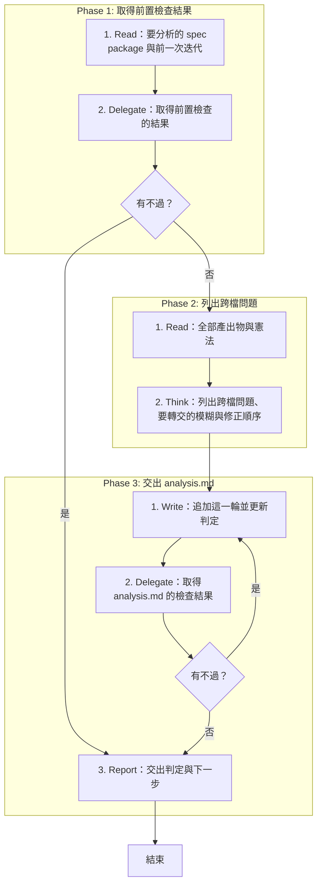

# SOP

## Phase 1: 取得前置檢查結果
1. Read **要分析的 spec package 與前一次迭代**:使用者沒有指定時,用 `specs/` 底下編號最大的資料夾;spec.md 有註明時記下那一次迭代的 plan.md。
2. Delegate 依 `rules/腳本執行-規範.md` 執行 `uv run scripts/preflight.py --package <spec package 的路徑>`(spec.md 註明建立在前一次迭代之上時,再加 `--previous-plan <前一次迭代的 plan.md 的路徑>`)**取得前置檢查的結果**;若有不過 → 跳至 Phase 3 Step 3。

## Phase 2: 列出跨檔問題
1. Read **全部產出物與憲法**:spec.md、research.md、techstack.md、plan.md,plan.md Documentation 樹列出的每一個規格檔與原型,tasks.md,`<專案根目錄>/constitution/` 底下的條文,以及既有的 analysis.md。
2. Think 依 `rules/問題-規範.md` **列出跨檔問題、要轉交的模糊與修正順序**:上一輪的問題逐一重判狀態,新問題寫出類別、嚴重度、位置與回哪一步。

## Phase 3: 交出 analysis.md
1. Write 依骨架 `templates/analysis.md` 與範例 `templates/analysis.example.md` 在 spec package **追加這一輪並更新判定**:沒有 analysis.md 時建立,其他產出物一律不改。
2. Delegate 執行 `uv run scripts/check_analysis.py --analysis <analysis.md 的路徑>` **取得 analysis.md 的檢查結果**;若有不過 → 跳至 Phase 3 Step 1。
3. Report **交出判定與下一步**:analysis.md 的路徑、這一輪的問題數、能不能進 `/implement`、要先回哪一支 Skill;前置檢查沒過時,改交出沒過的檢查與要退回的步驟。

🗺️ 流程視覺圖 (點擊展開/收合)

