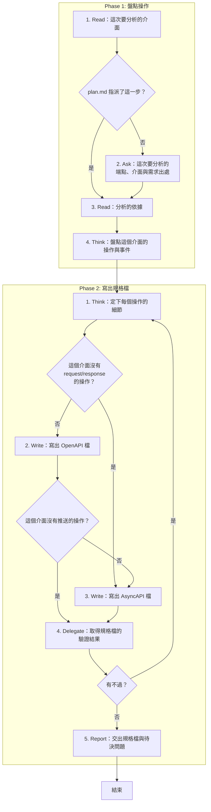

# SOP

## Phase 1: 盤點操作
1. Read **這次要分析的介面**:plan.md 的端點盤點與波段表裡指派給這次的那一步;若 plan.md 指派了這一步 → 跳至 Phase 1 Step 3。
2. Ask 問使用者**這次要分析的端點、介面與需求出處**。
3. Read **分析的依據**:spec.md、research.md、techstack.md,以及這一步的理由欄點名的前幾步產出。
4. Think **盤點這個介面的操作與事件**:每個需求出處都要對到至少一個操作或事件。

## Phase 2: 寫出規格檔
1. Think 依 `rules/契約-規範.md` **定下每個操作的細節**:請求、回應、錯誤與推送對象;若這個介面沒有 request/response 的操作 → 跳至 Phase 2 Step 3。
2. Write 依骨架 `templates/openapi.yaml` 與範例 `templates/openapi.example.yaml` 在 plan.md 的 Documentation 樹替這一步列的 `.openapi.yaml` 路徑(沒有 plan.md 時是 spec.md 旁的 `contracts/openapi.yaml`)**寫出 OpenAPI 檔**;若這個介面沒有推送的操作 → 跳至 Phase 2 Step 4。
3. Write 依骨架 `templates/asyncapi.yaml` 與範例 `templates/asyncapi.example.yaml` 在 plan.md 的 Documentation 樹替這一步列的 `.asyncapi.yaml` 路徑(沒有 plan.md 時是 spec.md 旁的 `contracts/asyncapi.yaml`)**寫出 AsyncAPI 檔**。
4. Delegate 依 `rules/腳本執行-規範.md` 執行 `uv run scripts/check_api.py --openapi <openapi.yaml 的路徑> --asyncapi <asyncapi.yaml 的路徑> --plan <plan.md 的路徑> --spec <spec.md 的路徑> --step <S 編號>` **取得規格檔的驗證結果**:沒寫的那一份省略它的參數;若有不過 → 跳至 Phase 2 Step 1。
5. Report **交出規格檔與待決問題**:拿不準、要使用者決定的事不在中途詢問,一起列在這裡。

🗺️ 流程視覺圖 (點擊展開/收合)

