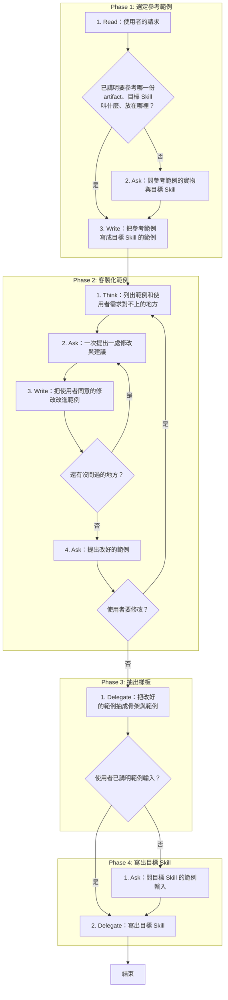
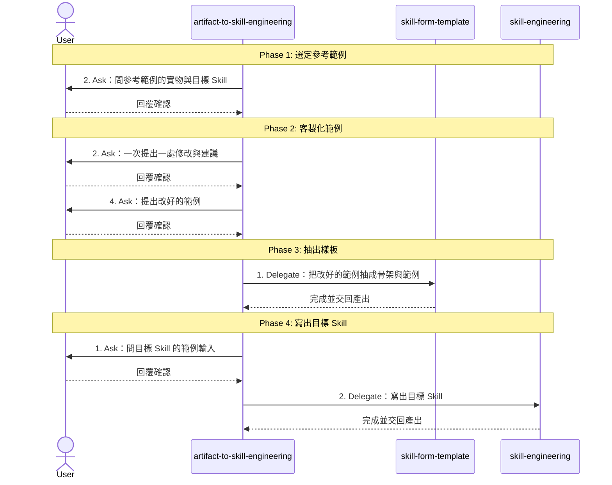

# SOP

## Phase 1: 選定參考範例
1. Read 依 `rules/參考範例-規範.md` **使用者的請求**;若已講明要參考哪一份 artifact、目標 Skill 叫什麼、放在哪裡 → 跳至 Phase 1 Step 3。
2. Ask **問參考範例的實物與目標 Skill**:參考 artifact 的檔案路徑、網址或貼上的全文,目標 Skill 叫什麼、放在哪裡。
3. Write 建立目標 Skill 的資料夾,`SKILL.md` 先只寫 frontmatter 的 name,**把參考範例寫成目標 Skill 的範例**,全文放在 `templates/` 底下。

## Phase 2: 客製化範例
1. Think **列出範例和使用者需求對不上的地方**,每一處附上建議的改法。
2. Ask **一次提出一處修改與建議**,問使用者要不要改、怎麼改。
3. Write **把使用者同意的修改改進範例**;若還有沒問過的地方 → 跳至 Phase 2 Step 2。
4. Ask **提出改好的範例**,問使用者是否滿意;若使用者要修改 → 跳至 Phase 2 Step 1。

## Phase 3: 抽出樣板
1. Delegate 轉交 skill-form-template,**把改好的範例抽成骨架與範例**;若使用者已講明範例輸入 → 跳至 Phase 4 Step 2。

## Phase 4: 寫出目標 Skill
1. Ask **問目標 Skill 的範例輸入**:使用者之後會交給它的一段輸入。
2. Delegate 轉交 skill-engineering,以骨架與範例為驗收產出、範例輸入為驗收輸入,**寫出目標 Skill**。

🗺️ 流程視覺圖 (點擊展開/收合)

