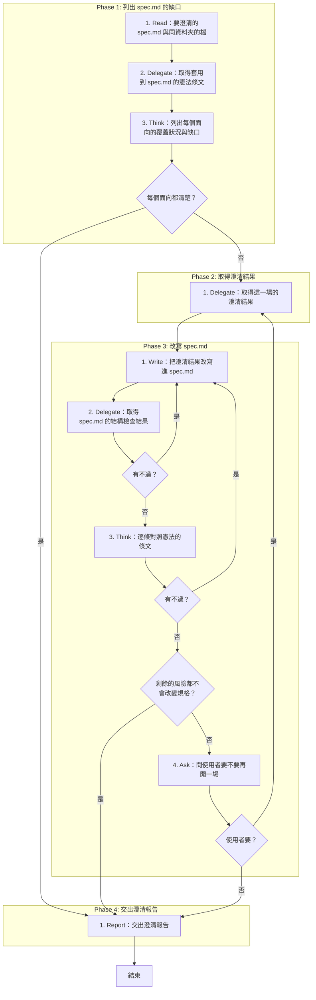
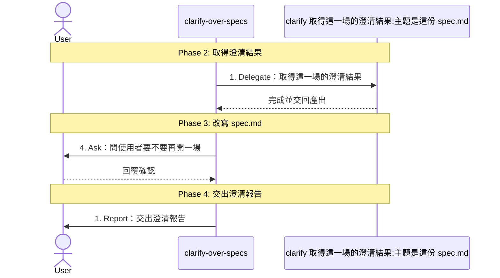

# SOP

## Phase 1: 列出 spec.md 的缺口
1. Read **要澄清的 spec.md 與同資料夾的檔**:使用者沒有指定時,用 `specs/` 底下編號最大的資料夾。
2. Delegate 依 `rules/腳本執行-規範.md` 執行 `uv run scripts/constitution_rules.py --constitution <專案根目錄>/constitution --artifact specify/spec` **取得套用到 spec.md 的憲法條文**。
3. Think 依 `rules/缺口面向-規範.md` **列出每個面向的覆蓋狀況與缺口**;若每個面向都清楚 → 跳至 Phase 4 Step 1。

## Phase 2: 取得澄清結果
1. Delegate 轉交 clarify **取得這一場的澄清結果**:主題是這份 spec.md,指定的提問面向是 Phase 1 列出的缺口,附上前幾場已拍板的決策,只在對話裡交還。

## Phase 3: 改寫 spec.md
1. Write 依 `rules/spec改寫-規範.md` **把澄清結果改寫進 spec.md**:決策寫進對應的章節,問答追加到釐清紀錄。
2. Delegate 執行 `uv run scripts/check_spec.py --spec <spec.md 的路徑>` **取得 spec.md 的結構檢查結果**;若有不過 → 跳至 Phase 3 Step 1。
3. Think **逐條對照憲法的條文**;若有不過 → 跳至 Phase 3 Step 1;若剩餘的風險都不會改變規格 → 跳至 Phase 4 Step 1。
4. Ask **問使用者要不要再開一場**;若使用者要 → 跳至 Phase 2 Step 1。

## Phase 4: 交出澄清報告
1. Report 依骨架 `templates/澄清報告.md` 與範例 `templates/澄清報告.example.md` **交出澄清報告**:問了幾題、改了哪些章節、各面向的覆蓋狀況、交給技術研究的項目、編號的變動與下一步。

🗺️ 流程視覺圖 (點擊展開/收合)

