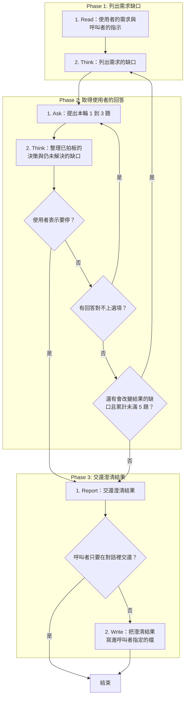

# SOP

## Phase 1: 列出需求缺口
1. Read **使用者的需求與呼叫者的指示**:要澄清的主題、指定的提問面向、要不要記錄問答。
2. Think 依 `rules/提問-規範.md` **列出需求的缺口**:缺漏、矛盾、模糊與未拍板的決策。

## Phase 2: 取得使用者的回答
1. Ask 依 `rules/Context與選項-規範.md`、骨架 `templates/提問.md` 與範例 `templates/提問.example.md` 在對話裡**提出本輪 1 到 3 題**,不用提問工具,請使用者依題號回答選項編號。
2. Think 依 `rules/決策-規範.md` **整理已拍板的決策與仍未解決的缺口**;若使用者表示要停 → 跳至 Phase 3 Step 1;若有回答對不上選項 → 跳至 Phase 2 Step 1;若還有會改變結果的缺口且累計未滿 5 題 → 跳至 Phase 1 Step 2。

## Phase 3: 交還澄清結果
1. Report 依骨架 `templates/澄清結果.md` 與範例 `templates/澄清結果.example.md` **交還澄清結果**:已確認的決策、使用者的補充與剩餘的風險;若呼叫者只要在對話裡交還 → 結束。
2. Write **把澄清結果寫進呼叫者指定的檔**。

🗺️ 流程視覺圖 (點擊展開/收合)

