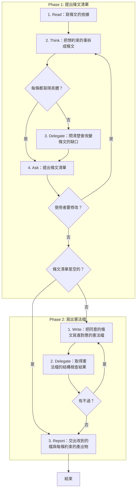
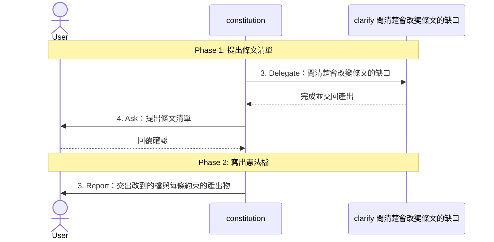

# SOP

## Phase 1: 提出條文清單
1. Read **寫條文的依據**:使用者想約束的事、專案現有的 `constitution/`,以及這些事涉及的 SDD Skill 的規範與樣板。
2. Think 依 `rules/條文-規範.md` **把想約束的事拆成條文**:每條歸到一個產出物或 `_shared/`,並對照 Skill 規範與現有條文;若每條都寫得具體 → 跳至 Phase 1 Step 4。
3. Delegate 轉交 clarify **問清楚會改變條文的缺口**。
4. Ask **提出條文清單**:每條的檔、標題、強度與它加嚴的地方,以及不寫成條文的事與原因,問使用者是否同意;若使用者要修改 → 跳至 Phase 1 Step 2;若條文清單是空的 → 跳至 Phase 2 Step 3。

## Phase 2: 寫出憲法檔
1. Write 依骨架 `templates/條文.md` 與範例 `templates/條文.example.md` **把同意的條文寫進對應的憲法檔**:新增的條文接在檔尾,修改的條文改寫原處。
2. Delegate 依 `rules/腳本執行-規範.md` 執行 `uv run scripts/check_constitution.py --constitution <constitution 資料夾的路徑>` **取得憲法檔的結構檢查結果**;若有不過 → 跳至 Phase 2 Step 1。
3. Report **交出改到的檔與每條約束的產出物**。

🗺️ 流程視覺圖 (點擊展開/收合)

