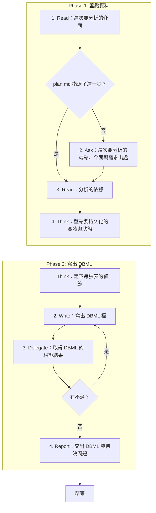

# SOP

## Phase 1: 盤點資料
1. Read **這次要分析的介面**:plan.md 的端點盤點與波段表裡指派給這次的那一步;若 plan.md 指派了這一步 → 跳至 Phase 1 Step 3。
2. Ask 問使用者**這次要分析的端點、介面與需求出處**。
3. Read **分析的依據**:spec.md、research.md、techstack.md,以及這一步的理由欄點名的前幾步產出。
4. Think **盤點要持久化的實體與狀態**:每個需求出處都要對到至少一張表。

## Phase 2: 寫出 DBML
1. Think 依 `rules/資料表-規範.md` **定下每張表的細節**:欄位、關聯、唯一性與狀態約束。
2. Write 依骨架 `templates/schema.dbml` 與範例 `templates/schema.example.dbml` 在 plan.md 的 Documentation 樹替這一步列的 `.dbml` 路徑(沒有 plan.md 時是 spec.md 旁的 `contracts/schema.dbml`)**寫出 DBML 檔**。
3. Delegate 依 `rules/腳本執行-規範.md` 執行 `uv run scripts/check_dbml.py --dbml <schema.dbml 的路徑> --plan <plan.md 的路徑> --spec <spec.md 的路徑> --step <S 編號>` **取得 DBML 的驗證結果**;若有不過 → 跳至 Phase 2 Step 2。
4. Report **交出 DBML 與待決問題**:拿不準、要使用者決定的事不在中途詢問,一起列在這裡。

🗺️ 流程視覺圖 (點擊展開/收合)

