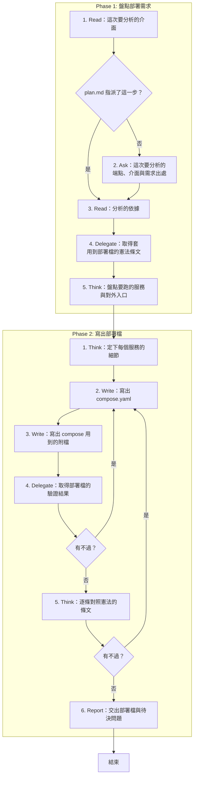

# SOP

## Phase 1: 盤點部署需求
1. Read **這次要分析的介面**:plan.md 的端點盤點與波段表裡指派給這次的那一步;若 plan.md 指派了這一步 → 跳至 Phase 1 Step 3。
2. Ask 問使用者**這次要分析的端點、介面與需求出處**。
3. Read **分析的依據**:spec.md、research.md、techstack.md,以及這一步的理由欄點名的前幾步產出。
4. Delegate 依 `rules/腳本執行-規範.md` 執行 `uv run scripts/constitution_rules.py --constitution <專案根目錄>/constitution --artifact deploy-plan/compose` **取得套用到部署檔的憲法條文**。
5. Think **盤點要跑的服務與對外入口**:每個需求出處都要對到至少一個服務。

## Phase 2: 寫出部署檔
1. Think 依 `rules/部署-規範.md` **定下每個服務的細節**:image、port、volume、環境變數與健康檢查。
2. Write 依骨架 `templates/compose.yaml` 與範例 `templates/compose.example.yaml` 在 plan.md 的 Documentation 樹替這一步列的資料夾(沒有 plan.md 時是 spec.md 旁的 `deploy/`)**寫出 `compose.yaml`**:前幾步已經寫過的就接著改。
3. Write 在同一個資料夾**寫出 compose 用到的附檔**:Dockerfile、`.env.example` 與反向代理設定,只寫 compose 用得到的。
4. Delegate 執行 `uv run scripts/check_deploy.py --compose <compose.yaml 的路徑> --plan <plan.md 的路徑> --spec <spec.md 的路徑> --step <S 編號>` **取得部署檔的驗證結果**;若有不過 → 跳至 Phase 2 Step 2。
5. Think **逐條對照憲法的條文**;若有不過 → 跳至 Phase 2 Step 2。
6. Report **交出部署檔與待決問題**,附上憲法的對照結果:拿不準、要使用者決定的事不在中途詢問,一起列在這裡。

🗺️ 流程視覺圖 (點擊展開/收合)

