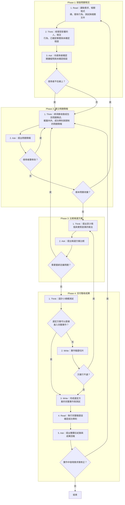

# SOP

## Phase 1: 探查問題現況
1. Read 讀取需求、相關程式碼、既有行為、測試與相關文件。
2. Think 依 `rules/探查-規範.md` 梳理受影響的人、現況行為、已確認事實與未確認假設。
3. Ask **向使用者確認關鍵疑問與未確認假設**;若使用者不在線上 → 跳至 Phase 2 Step 1。

## Phase 2: 確立問題簡報
1. Think 依 `rules/簡報-規範.md` 將洞察收斂成包含問題陳述、範圍內外、成功準則與限制的問題簡報。
2. Ask **提出問題簡報**並向使用者確認問題定義與範圍;若使用者要修改 → 跳至 Phase 2 Step 1;若根本問題改變 → 跳至 Phase 1 Step 1。

## Phase 3: 比較候選方案
1. Think 依 `rules/方案-規範.md` 針對問題簡報**提出至少兩個具實質差異的做法**並評估取捨。
2. Ask **提出候選方案比較**並請使用者確認做法;若需要重新定義問題 → 跳至 Phase 2 Step 1。

## Phase 4: 交付驗收成果
1. Think 依 `rules/交付-規範.md` **設計小規模測試**驗證方案中最不確定之處;若選定方案可以直接進入完整實作 → 跳至 Phase 4 Step 3。
2. Write **實作驗證切片**並確認驗證結果;若方案行不通 → 跳至 Phase 3 Step 1。
3. Write **完成選定方案的完整實作與測試**。
4. Read **執行完整驗證並確認成功準則**。
5. Ask 依骨架 `templates/雙鑽石紀錄.md` 與範例 `templates/雙鑽石紀錄.example.md` **提出雙鑽石紀錄與成果回報**並等使用者確認;若實作中發現需求需修正 → 跳至 Phase 2 Step 1。

🗺️ 流程視覺圖 (點擊展開/收合)

