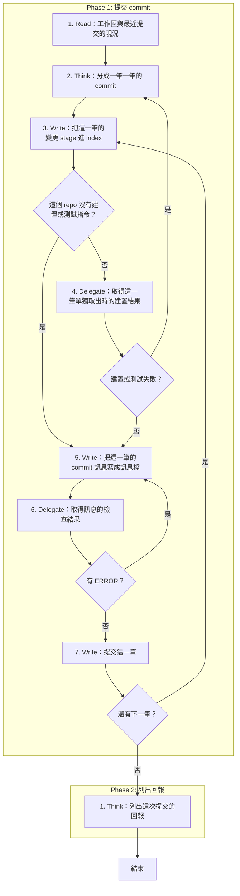

# SOP

## Phase 1: 提交 commit
1. Read **工作區與最近提交的現況**:`git status`、`git diff`、`git diff --staged` 與 `git log -n 15 --format='%h %s'` 的輸出。
2. Think 依 `rules/提交計畫-規範.md` 把這批變更**分成一筆一筆的 commit** 並排出提交的順序。
3. Write 依 `rules/index-規範.md` **把這一筆的變更 stage 進 index**;若這個 repo 沒有建置或測試指令 → 跳至 Phase 1 Step 5。
4. Delegate 依 `rules/腳本執行-規範.md` 執行 `uv run scripts/verify_staged.py --repo <repo 根目錄> --link <被 gitignore 的建置相依> --cmd <建置與測試指令>` **取得這一筆單獨取出時的建置結果**;若建置或測試失敗 → 跳至 Phase 1 Step 2。
5. Write 依 `rules/commit-message-規範.md`、骨架 `templates/commit-message.txt` 與範例 `templates/commit-message.example.txt` **把這一筆的 commit 訊息寫成訊息檔**。
6. Delegate 執行 `uv run scripts/check_commit_msg.py --file <訊息檔>` **取得訊息的檢查結果**;若有 ERROR → 跳至 Phase 1 Step 5。
7. Write 以 `git commit -F <訊息檔>` **提交這一筆**;若還有下一筆 → 跳至 Phase 1 Step 3。

## Phase 2: 列出回報
1. Think 依 `rules/回報-規範.md`、骨架 `templates/回報.md` 與範例 `templates/回報.example.md` **列出這次提交的回報**。

🗺️ 流程視覺圖 (點擊展開/收合)

