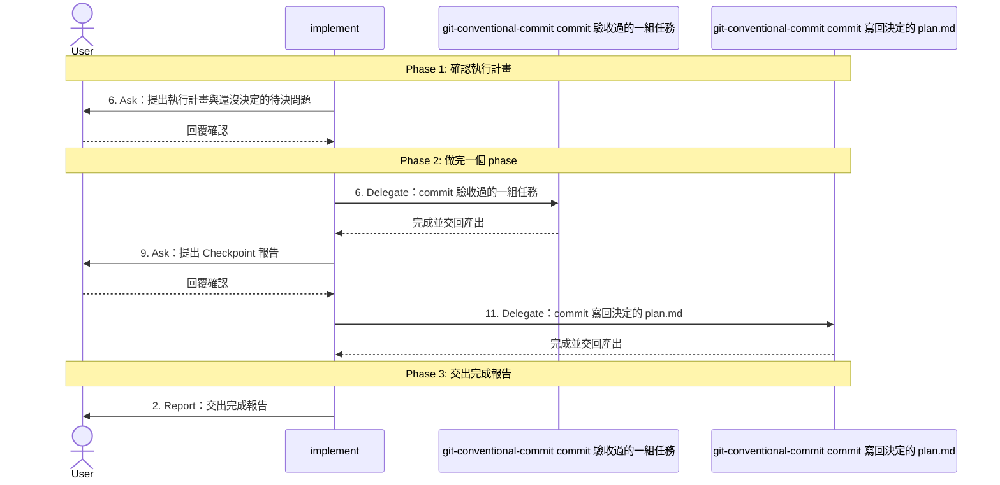

# SOP

## Phase 1: 確認執行計畫
1. Read **開工的依據**:使用者指定的範圍、tasks.md、plan.md 的待決問題,以及 spec.md、research.md、techstack.md。
2. Delegate 依 `rules/腳本執行-規範.md` 執行 `uv run scripts/check_tasks.py --tasks <tasks.md 的路徑> --package <spec package 的路徑>` **取得錨點與覆蓋的檢查結果**;若有不過 → 結束。
3. Read spec package 裡 **analysis.md 最新一輪的判定**:沒有 analysis.md 就沒有判定;若判定是 ⛔ 不能進 `/implement` → 結束。
4. Delegate 執行 `uv run scripts/plan_scope.py --tasks <tasks.md 的路徑> --plan <plan.md 的路徑> --scope <範圍>` **取得範圍內的任務與待決問題**。
5. Think 依 `rules/執行計畫-規範.md` **排出執行計畫**:每個 phase 的任務順序、由主 agent 還是哪個端點的 subagent 做。
6. Ask 依骨架 `templates/執行計畫.md` 與範例 `templates/執行計畫.example.md` **提出執行計畫與還沒決定的待決問題**,問使用者每一題怎麼決定、計畫要不要修改;若計畫要修改 → 跳至 Phase 1 Step 5。
7. Write 把使用者的決定**寫回 plan.md 的待決問題**。

## Phase 2: 做完一個 phase
1. Read **這個 phase 的任務依據**:每個任務 ⚙ 指到的規格元素與 📎 指到的段落。
2. Write 依 `rules/實作-規範.md` **依序做完由主 agent 做的任務**;若這個 phase 是 Setup、Foundational 或 Polish → 跳至 Phase 2 Step 4。
3. Delegate 依骨架 `templates/端點指示.md` 與範例 `templates/端點指示.example.md` **把每個端點節交給 subagent 平行實作**。
4. Think 依 `rules/驗收-規範.md` **逐一驗收做完的任務**;若有任務不過 → 跳至 Phase 2 Step 2。
5. Write **勾選驗收過的任務**。
6. Delegate 依 `rules/提交-規範.md` 轉交 git-conventional-commit **commit 驗收過的一組任務**。
7. Read 這個 phase 的 **Checkpoint 指令執行的結果**;若有和停下的任務無關的不過 → 跳至 Phase 2 Step 2。
8. Delegate 執行 `uv run scripts/check_phase.py --tasks <tasks.md 的路徑> --phase <phase 序號> --plan <plan.md 的路徑>` **取得勾選與待決問題表的檢查結果**,描述開頭標 ⏸ 的延後任務列在 `paused_tasks`、不算沒勾;若有沒勾、也沒停下的任務,或待決問題表有格式不符的列 → 跳至 Phase 2 Step 2。
9. Ask 依骨架 `templates/Checkpoint報告.md` 與範例 `templates/Checkpoint報告.example.md` **提出 Checkpoint 報告**,問使用者要手動確認的項目過了沒有、這個 phase 登記的待決問題怎麼決定、可不可以往下做。
10. Write 把使用者的決定**寫回 plan.md 的待決問題**。
11. Delegate 轉交 git-conventional-commit **commit 寫回決定的 plan.md**;若有停下的任務、手動確認沒過或範圍內還有下一個 phase → 跳至 Phase 2 Step 1。

## Phase 3: 交出完成報告
1. Think **對過範圍內每條 SC 的量測結果**:有數字的寫出數字,量不到的標未驗證。
2. Report 依骨架 `templates/完成報告.md` 與範例 `templates/完成報告.example.md` **交出完成報告**。

```mermaid
flowchart TD
    subgraph P1["Phase 1: 確認執行計畫"]
        P1S1["1. Read：開工的依據"]
        P1S2["2. Delegate：取得錨<br/>點與覆蓋的檢查結果"]
        G_P1S2_1{"有不過？"}
        P1S3["3. Read：analysis.md 最新一輪的判定"]
        G_P1S3_1{"判定是 ⛔ 不能進<br/>/implement？"}
        P1S4["4. Delegate：取得範<br/>圍內的任務與待決問題"]
        P1S5["5. Think：排出執行計畫"]
        P1S6["6. Ask：提出執行計畫<br/>與還沒決定的待決問題"]
        G_P1S6_1{"計畫要修改？"}
        P1S7["7. Write：寫回 plan.md 的待決問題"]
    end
    subgraph P2["Phase 2: 做完一個 phase"]
        P2S1["1. Read：這個 phase 的任務依據"]
        P2S2["2. Write：依序做完<br/>由主 agent 做的任務"]
        G_P2S2_1{"這個 phase 是 Setup、<br/>Foundational 或 Polish？"}
        P2S3["3. Delegate：把每個端點<br/>節交給 subagent 平行實作"]
        P2S4["4. Think：逐一驗收做完的任務"]
        G_P2S4_1{"有任務不過？"}
        P2S5["5. Write：勾選驗收過的任務"]
        P2S6["6. Delegate：commit 驗收過的一組任務"]
        P2S7["7. Read：Checkpoint 指令執行的結果"]
        G_P2S7_1{"有和停下的任務<br/>無關的不過？"}
        P2S8["8. Delegate：取得勾選<br/>與待決問題表的檢查結果"]
        G_P2S8_1{"有沒勾、也沒停下的<br/>任務,或待決問題表<br/>有格式不符的列？"}
        P2S9["9. Ask：提出 Checkpoint 報告"]
        P2S10["10. Write：寫回 plan.md 的待決問題"]
        P2S11["11. Delegate：commit<br/>寫回決定的 plan.md"]
        G_P2S11_1{"有停下的任務、手動<br/>確認沒過或範圍內還<br/>有下一個 phase？"}
    end
    subgraph P3["Phase 3: 交出完成報告"]
        P3S1["1. Think：對過範圍內<br/>每條 SC 的量測結果"]
        P3S2["2. Report：交出完成報告"]
    end
    End["結束"]
    P1S1 --> P1S2
    P1S2 --> G_P1S2_1
    G_P1S2_1 -->|是| End
    G_P1S2_1 -->|否| P1S3
    P1S3 --> G_P1S3_1
    G_P1S3_1 -->|是| End
    G_P1S3_1 -->|否| P1S4
    P1S4 --> P1S5
    P1S5 --> P1S6
    P1S6 --> G_P1S6_1
    G_P1S6_1 -->|是| P1S5
    G_P1S6_1 -->|否| P1S7
    P1S7 --> P2S1
    P2S1 --> P2S2
    P2S2 --> G_P2S2_1
    G_P2S2_1 -->|是| P2S4
    G_P2S2_1 -->|否| P2S3
    P2S3 --> P2S4
    P2S4 --> G_P2S4_1
    G_P2S4_1 -->|是| P2S2
    G_P2S4_1 -->|否| P2S5
    P2S5 --> P2S6
    P2S6 --> P2S7
    P2S7 --> G_P2S7_1
    G_P2S7_1 -->|是| P2S2
    G_P2S7_1 -->|否| P2S8
    P2S8 --> G_P2S8_1
    G_P2S8_1 -->|是| P2S2
    G_P2S8_1 -->|否| P2S9
    P2S9 --> P2S10
    P2S10 --> P2S11
    P2S11 --> G_P2S11_1
    G_P2S11_1 -->|是| P2S1
    G_P2S11_1 -->|否| P3S1
    P3S1 --> P3S2
    P3S2 --> End
```

🗺️ 流程視覺圖 (點擊展開/收合)

