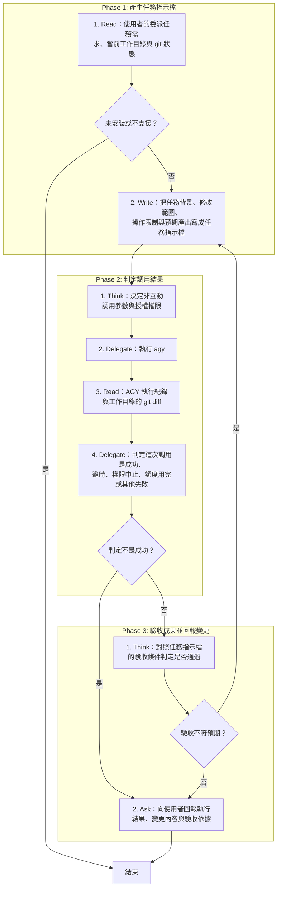

# SOP

## Phase 1: 產生任務指示檔
1. Read 使用者的委派任務需求、當前工作目錄與 git 狀態;若 agy 未安裝或環境不支援 → 結束。
2. Write 依骨架 `templates/task-prompt.md` 與範例 `templates/task-prompt.example.md` 把任務背景、修改範圍、操作限制與預期產出寫成任務指示檔。

## Phase 2: 判定調用結果
1. Think 依 `rules/調用-規範.md` 決定非互動調用參數與授權權限。
2. Delegate 執行 agy --print 指令傳入任務指示檔並將最後輸出寫入紀錄檔。
3. Read AGY 執行紀錄與工作目錄的 git diff。
4. Delegate 依 `rules/腳本執行-規範.md` 執行 `uv run scripts/judge_invocation.py --json <JSON 紀錄檔> --stderr <stderr 紀錄檔> --exit <結束碼紀錄檔>` 判定這次調用是成功、逾時、權限中止、額度用完或其他失敗;若判定不是成功 → 跳至 Phase 3 Step 2。

## Phase 3: 驗收成果並回報變更
1. Think 對照任務指示檔的驗收條件判定是否通過;若結果不符預期且需要 AGY 修正,而這次還沒有修正過 → 跳至 Phase 1 Step 2。
2. Ask 向使用者回報執行結果、變更內容與驗收依據。

🗺️ 流程視覺圖 (點擊展開/收合)

