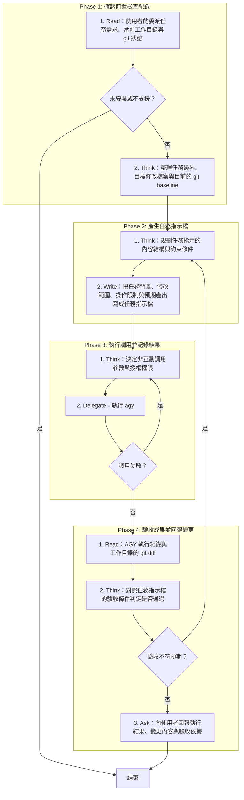

# SOP

🗺️ 流程視覺圖 (點擊展開/收合)

## Phase 1: 確認前置檢查紀錄
1. Read 使用者的委派任務需求、當前工作目錄與 git 狀態;若 agy 未安裝或環境不支援 → 結束。
2. Think 整理任務邊界、目標修改檔案與目前的 git baseline。

## Phase 2: 產生任務指示檔
1. Think 規劃任務指示的內容結構與約束條件。
2. Write 依骨架 `templates/task-prompt.md` 與範例 `templates/task-prompt.example.md` 把任務背景、修改範圍、操作限制與預期產出寫成任務指示檔。

## Phase 3: 執行調用並記錄結果
1. Think 依 `rules/調用-規範.md` 決定非互動調用參數與授權權限。
2. Delegate 執行 agy --print 指令傳入任務指示檔並將最後輸出寫入紀錄檔;若調用失敗 → 跳至 Phase 3 Step 1。

## Phase 4: 驗收成果並回報變更
1. Read AGY 執行紀錄與工作目錄的 git diff。
2. Think 對照任務指示檔的驗收條件判定是否通過;若結果不符預期且需要 AGY 修正 → 跳至 Phase 2 Step 1。
3. Ask 向使用者回報執行結果、變更內容與驗收依據。
