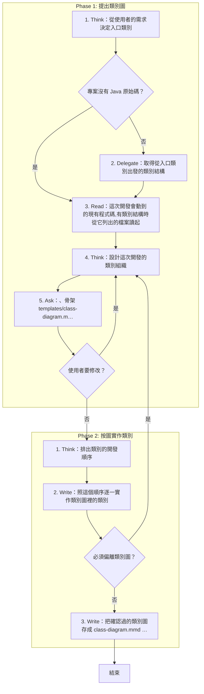

# SOP

🗺️ 流程視覺圖 (點擊展開/收合)

## Phase 1: 提出類別圖
1. Think 從使用者的需求決定入口類別;若專案沒有 Java 原始碼 → 跳至 Phase 1 Step 3。
2. Delegate 依 `rules/腳本執行-規範.md` 執行 `uv run scripts/parse_class_structure.py --root <專案根目錄> --entry <入口類別> --max-classes 30` 取得從入口類別出發的類別結構。
3. Read 這次開發會動到的現有程式碼,有類別結構時從它列出的檔案讀起。
4. Think 依 `rules/類別圖-規範.md` 設計這次開發的類別組織。
5. Ask 依 `rules/確認-規範.md`、骨架 `templates/class-diagram.mmd` 與範例 `templates/class-diagram.example.mmd` 用 Mermaid `classDiagram` 提出這份設計,問使用者是否可以進入開發;若使用者要修改 → 跳至 Phase 1 Step 4。

## Phase 2: 按圖實作類別
1. Think 依 `rules/實作-規範.md` 排出類別的開發順序。
2. Write 依 `rules/實作-偏離-規範.md` 照這個順序逐一實作類別圖裡的類別;若必須偏離類別圖 → 跳至 Phase 1 Step 4。
3. Write 把確認過的類別圖存成 `class-diagram.mmd` 檔案放到專案根目錄或適當的文件目錄。
