# Rule 1 [must] - 只畫這次開發涉及的類別
- 涉及的類別只有兩種:這次會新增或修改的類別,以及這次新增的關係所連到的現有類別
- 為什麼:把用不到的現有類別也畫進來,這次的變更會被淹沒,使用者找不到他要確認的那幾個類別

## good example
- 這次開發是「下單前先檢查庫存」;圖上**只有要修改的 `OrderService` 和新增的 `InventoryChecker`**
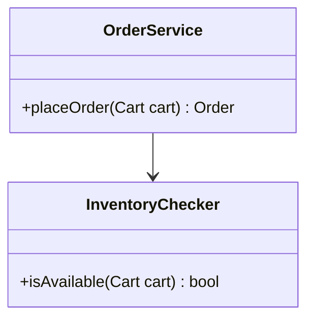

## bad example
- 同一次開發,但**把同一個模組裡的 `CouponService`、`UserService` 也畫進來**;這次不會改它們,也沒有新的關係連到它們
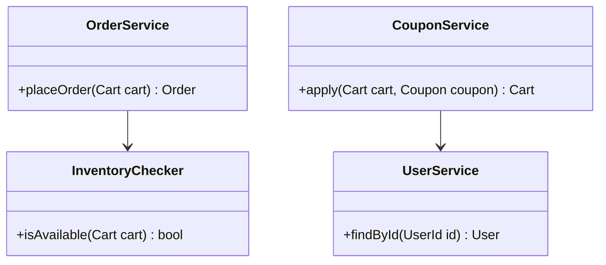

## good example
- 邊界:`StockRepository` 是現有的類別、這次也不會改,但**新增的 `InventoryChecker` 相依它,這條關係是這次才有的**,所以要畫
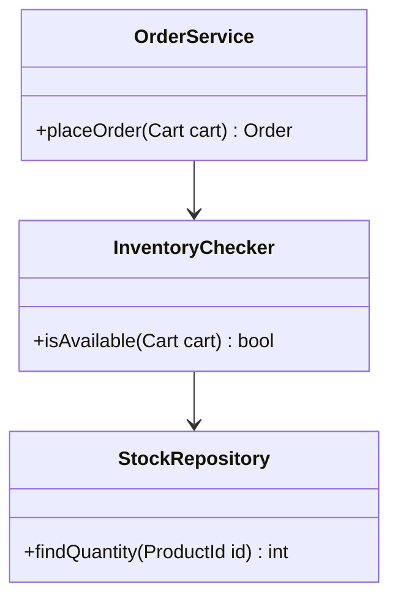

## bad example
- 邊界:同一張圖多畫了 `PaymentGateway`;它和要修改的 `OrderService` 確實有關係,但**那條關係本來就在、這次沒有變**,不屬於這次開發
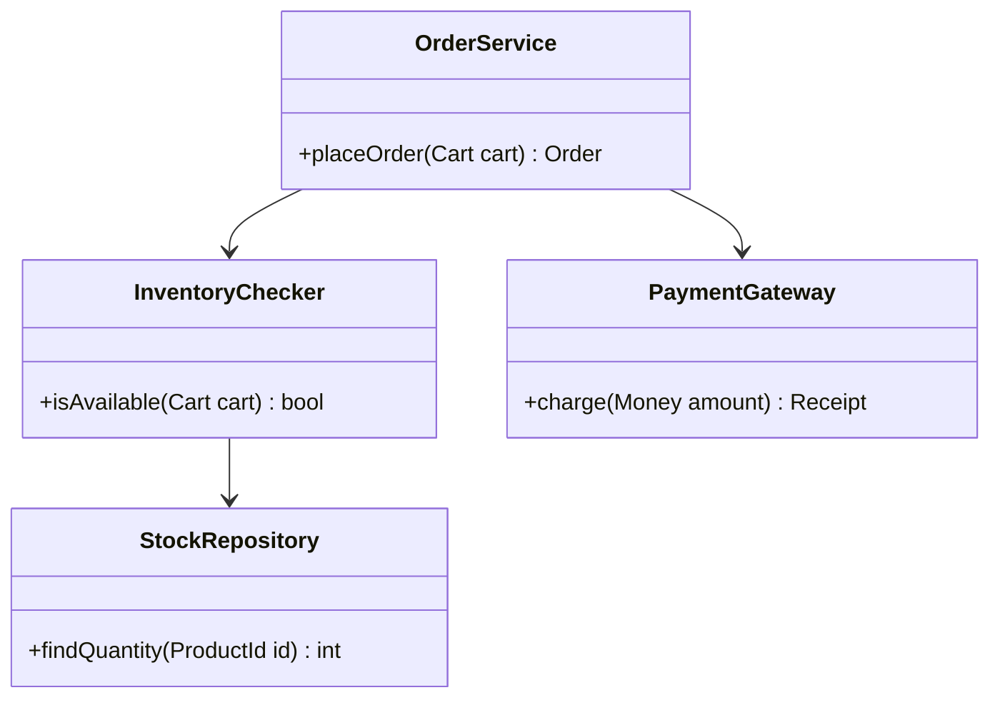

# Rule 2 [must] - 成員區只放對外成員
- 類別框裡只列 public 的方法與屬性,private 成員不畫
- 為什麼:圖上畫出來的成員就是使用者確認過的範圍;把 private 也畫進去,實作時每一次內部調整都變成偏離類別圖,得停下來重新確認

## good example
- 類別框裡**只有別的類別會呼叫的 `isAvailable`**
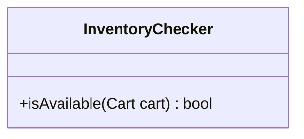

## bad example
- 同一個類別,但**把內部用的方法與欄位也畫進來**;之後只要改個 private 方法的名字,就和圖對不上
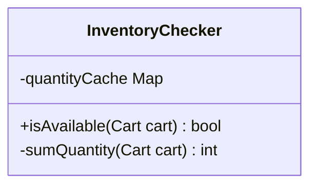

# Rule 3 [must] - 方法寫出參數與回傳型別
- 每個方法寫成 `+<方法名>(<型別> <參數名>, ...) <回傳型別>`;沒有回傳值就不寫回傳型別
- 為什麼:只有方法名稱,使用者確認不到類別之間實際交換的是什麼資料,實作時參數怎麼定也沒有依據

## good example
- **看得出 `isAvailable` 收一個 `Cart`、回一個 `bool`**

## bad example
- 同一個方法,但**只有名稱**;它是收整個購物車還是收單一商品、回布林還是回缺貨清單,圖上看不出來
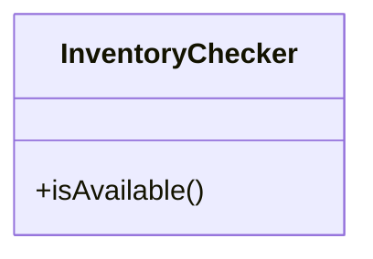

# Rule 4 [must] - 關係依箭頭表畫
- 每一條關係依下表選種類,寫法照表下的 code section;每一種寫法都是左邊相依右邊

| 關係 | 什麼時候用 |
|---|---|
| 繼承 | Child 繼承 Parent |
| 實作 | Impl 實作 Interface |
| 組合 | Part 是 Whole 的一部分,由 Whole 建立,不單獨存在 |
| 聚合 | Part 是 Whole 的一部分,但離開 Whole 仍然存在 |
| 關聯 | A 用欄位持有 B,呼叫它做事 |
| 相依 | A 沒有欄位持有 B,只在方法的參數、回傳值或方法內部用到 B |

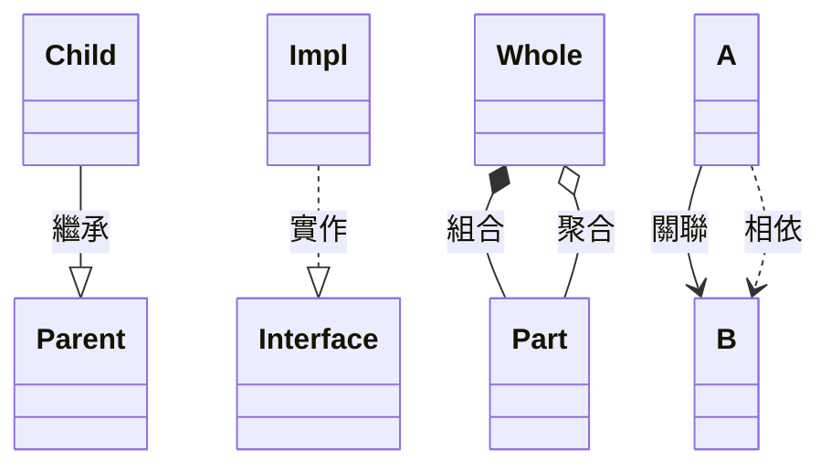

- 為什麼:開發順序是照「右邊的先做」排出來的;種類選錯或左右寫反,順序就跟著錯,使用者看到的關係也和實際寫出來的不一樣

## good example
- `OrderService` 用欄位持有 `InventoryChecker`,所以是關聯,而且**相依別人的 `OrderService` 在左邊**
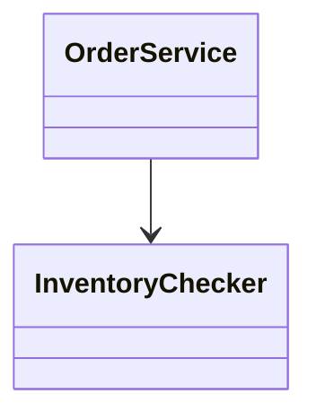

## bad example
- 同一條關係,但**左右寫反**;照這張圖排順序,會先做 `OrderService`,那時候 `InventoryChecker` 還不存在
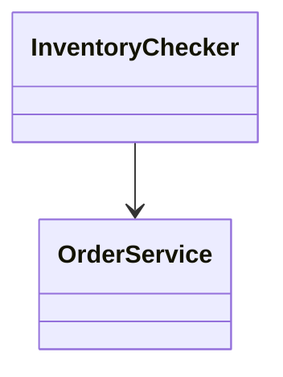

## good example
- 邊界:`InventoryChecker` 只在 `isAvailable` 的參數用到 `Cart`,**沒有欄位持有它,所以是相依**
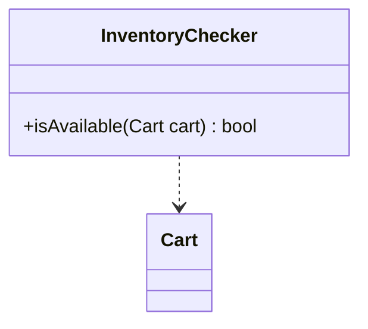

## bad example
- 邊界:同一個類別,兩者確實有關係,但**畫成關聯**;讀圖的人會以為 `InventoryChecker` 有一個 `Cart` 欄位
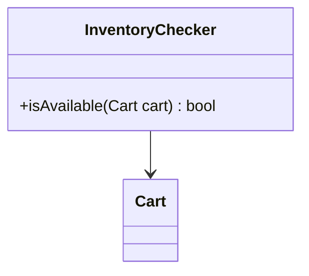

# Rule 5 [should] - 每個類別附一句職責
- 用 `note for <類別> "<職責>"` 寫一句話,說明這個類別負責的那一件事
- 為什麼:類別框裡沒有地方放職責;沒寫出來,使用者只看得到方法名稱,確認不了職責分得對不對

## good example
- **不用讀方法,也知道 `InventoryChecker` 是做什麼的**
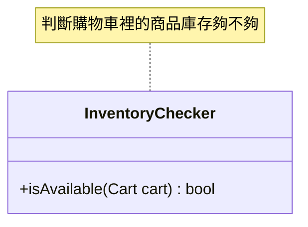

## bad example
- 同一個類別,但**沒有職責**;使用者只能從 `isAvailable` 這個名字去猜

## good example
- 邊界:一句話、**只講一件事**

## bad example
- 邊界:同樣是一句話,但**用「並」接了第二件事**;通知採購不是判斷庫存,這個類別該拆成兩個
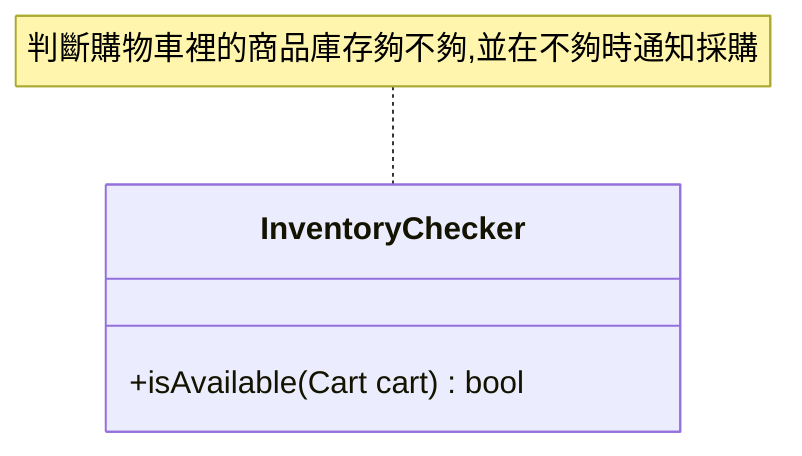

# Rule 6 [must] - 一個類別只寫一個 `<<…>>`
- 要同時標兩件事(例如這次新增的 interface),合併成 `<<新增 interface>>` 這樣的寫法
- 為什麼:Mermaid 只會畫出類別框裡的第一個 `<<…>>`,第二個寫了也不會出現在圖上

## good example
- `StockReader` 是這次新增的 interface,**兩個資訊寫在同一個 `<<…>>` 裡**
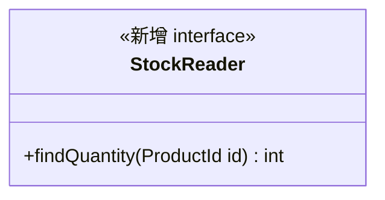

## bad example
- 同一個類別,兩個標記都寫了、語法也沒錯,但**圖上只會出現 `<<interface>>`**,看不出它是新增的
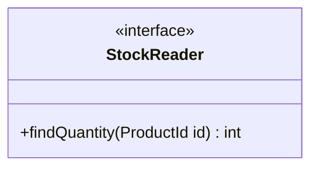
