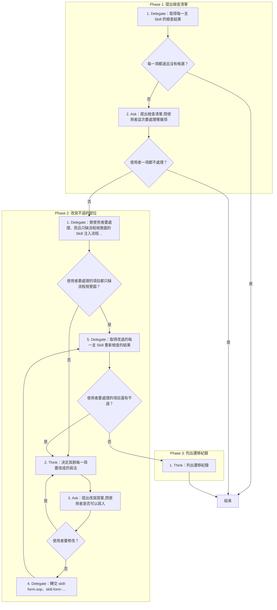
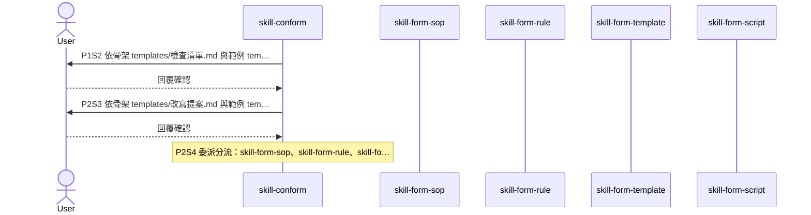

# SOP

🗺️ 流程視覺圖 (點擊展開/收合)

## Phase 1: 提出檢查清單
1. Delegate 依 `rules/腳本執行-規範.md` 執行 `uv run scripts/check_skills.py --skills <放 Skill 的目錄>` 取得每一支 Skill 的檢查結果;若每一項都過且沒有候選 → 結束。
2. Ask 依骨架 `templates/檢查清單.md` 與範例 `templates/檢查清單.example.md` 提出檢查清單,問使用者這次要處理哪幾項;若使用者一項都不處理 → 結束。

## Phase 2: 改寫不過的部位
1. Delegate 執行 `uv run scripts/check_skills.py --skills <放 Skill 的目錄> --only <只缺流程視覺圖的 Skill 名稱> --write-diagrams` 替使用者要處理、而且只缺流程視覺圖的 Skill 注入流程視覺圖;若使用者要處理的項目都只缺流程視覺圖 → 跳至 Phase 2 Step 5。
2. Think 決定其餘每一項要改成的寫法。
3. Ask 依骨架 `templates/改寫提案.md` 與範例 `templates/改寫提案.example.md` 提出改寫提案,問使用者是否可以寫入;若使用者要修改 → 跳至 Phase 2 Step 2。
4. Delegate 轉交 skill-form-sop、skill-form-rule、skill-form-template 或 skill-form-script,照確認過的寫法改寫使用者要處理的其餘每一項。
5. Delegate 執行 `uv run scripts/check_skills.py --skills <放 Skill 的目錄> --only <改過的 Skill 名稱>` 取得改過的每一支 Skill 重新檢查的結果;若使用者要處理的項目還有不過 → 跳至 Phase 2 Step 2。

## Phase 3: 列出遷移紀錄
1. Think 依骨架 `templates/遷移紀錄.md` 與範例 `templates/遷移紀錄.example.md` 列出遷移紀錄。
