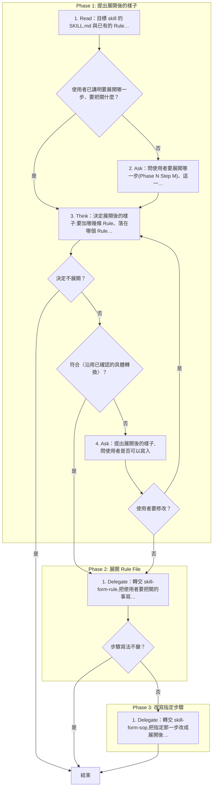
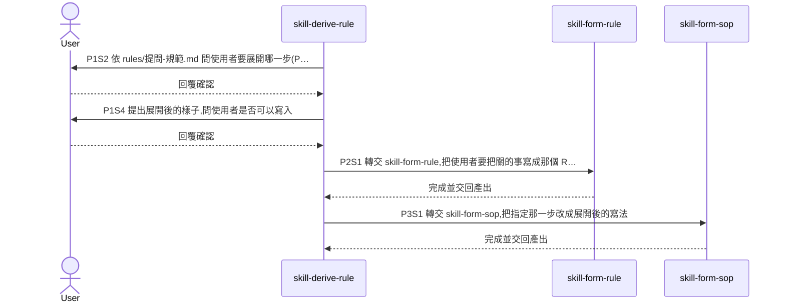

# SOP

🗺️ 流程視覺圖 (點擊展開/收合)

## Phase 1: 提出展開後的樣子
1. Read 目標 skill 的 SKILL.md 與已有的 Rule File;若使用者已講明要展開哪一步、要把關什麼 → 跳至 Phase 1 Step 3。
2. Ask 依 `rules/提問-規範.md` 問使用者要展開哪一步(Phase N Step M)、這一步要把關什麼。
3. Think 依 `rules/展開-規範.md` 決定展開後的樣子:要加哪幾條 Rule、落在哪個 Rule File、指定那一步改成什麼寫法;若決定不展開 → 結束;若符合〈沿用已確認的具體轉換〉 → 跳至 Phase 2 Step 1。
4. Ask 提出展開後的樣子,問使用者是否可以寫入;若使用者要修改 → 跳至 Phase 1 Step 3。

## Phase 2: 展開 Rule File
1. Delegate 轉交 skill-form-rule,把使用者要把關的事寫成那個 Rule File 的 Rule;若指定那一步的寫法不變 → 結束。

## Phase 3: 改寫指定步驟
1. Delegate 轉交 skill-form-sop,把指定那一步改成展開後的寫法。
