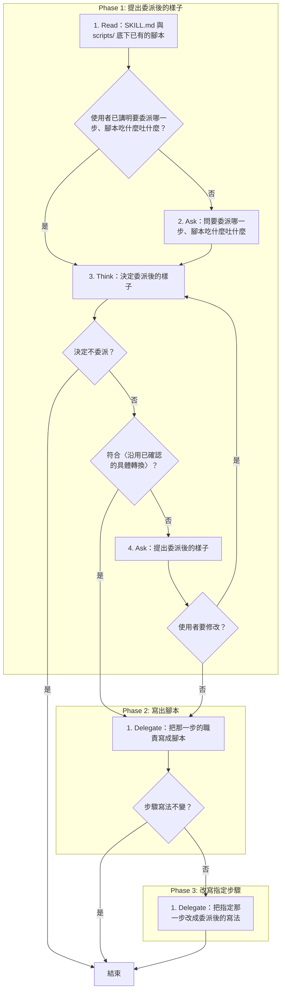
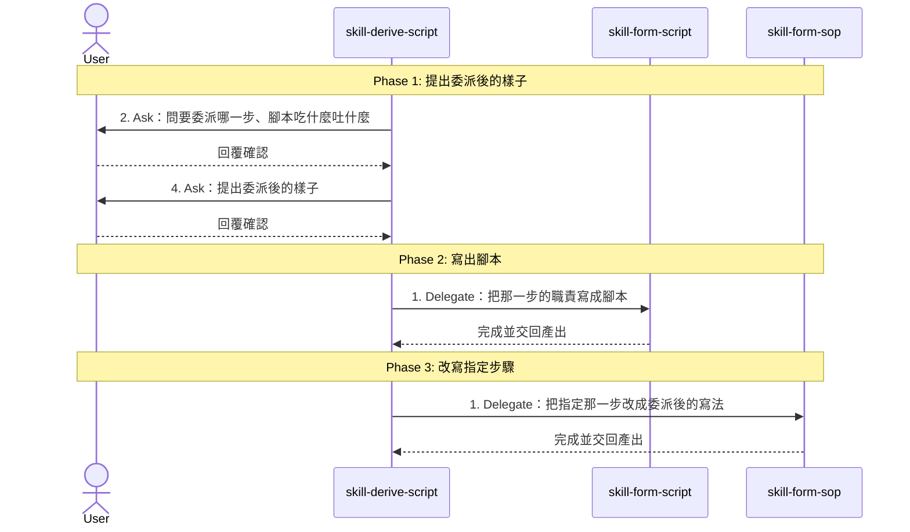

# SOP

## Phase 1: 提出委派後的樣子
1. Read 目標 skill 的 **SKILL.md 與 `scripts/` 底下已有的腳本**;若使用者已講明要委派哪一步、腳本吃什麼吐什麼 → 跳至 Phase 1 Step 3。
2. Ask 依 `rules/提問-規範.md` **問要委派哪一步、腳本吃什麼吐什麼**(哪一步寫成 Phase N Step M)。
3. Think 依 `rules/委派-規範.md` **決定委派後的樣子**:腳本檔名、參數與輸出、第三方套件、指定那一步改成什麼寫法;若決定不委派 → 結束;若符合〈沿用已確認的具體轉換〉 → 跳至 Phase 2 Step 1。
4. Ask **提出委派後的樣子**,問使用者是否可以寫入;若使用者要修改 → 跳至 Phase 1 Step 3。

## Phase 2: 寫出腳本
1. Delegate 轉交 skill-form-script,**把那一步的職責寫成腳本**;若指定那一步的寫法不變 → 結束。

## Phase 3: 改寫指定步驟
1. Delegate 轉交 skill-form-sop,**把指定那一步改成委派後的寫法**。

🗺️ 流程視覺圖 (點擊展開/收合)

