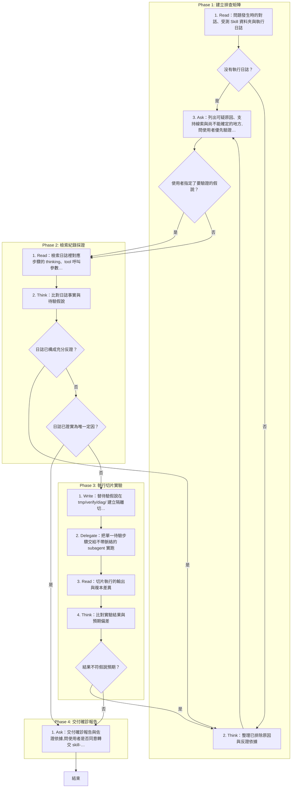

# SOP

🗺️ 流程視覺圖 (點擊展開/收合)

## Phase 1: 建立排查矩陣
1. Read 問題發生時的對話、受測 Skill 資料夾與執行日誌;若沒有執行日誌 → 跳至 Phase 1 Step 3。
2. Think 整理已排除原因與反證依據。
3. Ask 依骨架 `templates/排查矩陣.md` 與範例 `templates/排查矩陣.example.md` 列出可疑原因、支持線索與尚不能確定的地方,問使用者優先驗證哪一項;若使用者指定了要驗證的假說 → 跳至 Phase 2 Step 1。

## Phase 2: 檢索紀錄採證
1. Read 依 `rules/採證-規範.md` 檢索日誌裡對應步驟的 thinking、tool 呼叫參數與返回值。
2. Think 比對日誌事實與待驗假說;若日誌已構成充分反證 → 跳至 Phase 1 Step 2;若日誌已證實為唯一定因 → 跳至 Phase 4 Step 1。

## Phase 3: 執行切片實驗
1. Write 替待驗假說在 `tmp/verify/diag/` 建立隔離切片目錄,填入前置步驟的假產出。
2. Delegate 把單一待驗步驟交給不帶脈絡的 subagent 實跑。
3. Read 切片執行的輸出與複本差異。
4. Think 比對實驗結果與預期偏差;若結果不符假說預期 → 跳至 Phase 1 Step 2。

## Phase 4: 交付確診報告
1. Ask 依骨架 `templates/確診報告.md` 與範例 `templates/確診報告.example.md` 交付確診報告與佐證依據,問使用者是否同意轉交 skill-engineering 進入修復。
