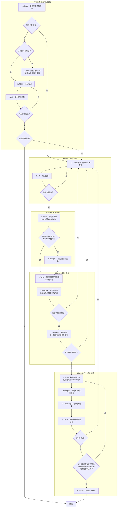
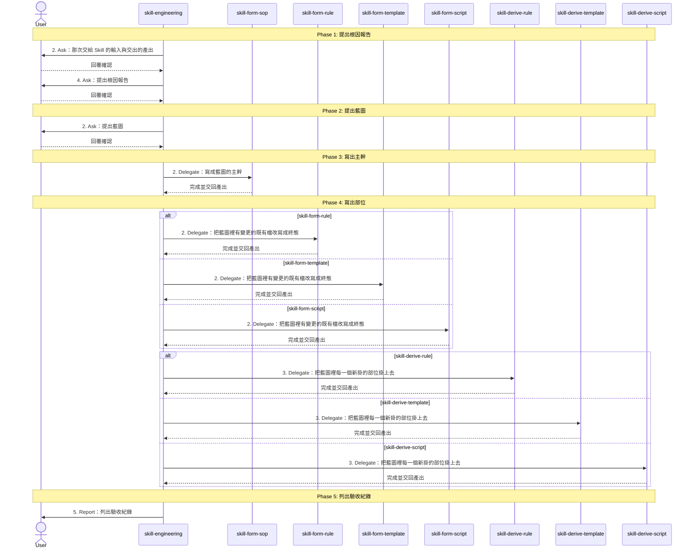

# SOP

## Phase 1: 提出根因報告
1. Read **問題發生時的現場**:當時的對話與用到的每一支 Skill 的整個資料夾;若要創建的是全新的 Skill → 跳至 Phase 2 Step 1;若對話裡有那次交給 Skill 的輸入與交出的產出 → 跳至 Phase 1 Step 3。
2. Ask 問使用者**那次交給 Skill 的輸入與交出的產出**。
3. Think 依 `rules/根因-規範.md` 用當時的輸入逐步演練每一支 Skill 的 SOP **找出根因**。
4. Ask 依骨架 `templates/根因報告.md` 與範例 `templates/根因報告.example.md` **提出根因報告**,問使用者是否同意;若使用者不同意 → 跳至 Phase 1 Step 3;若使用者同意,而每一個落差都不歸類 → 結束。

## Phase 2: 提出藍圖
1. Think 依 `rules/藍圖-規範.md` **決定目標 Skill 的藍圖**:產出鏈、主幹、變更與新掛部位的樣子。
2. Ask 依骨架 `templates/藍圖.md` 與範例 `templates/藍圖.example.md` **提出藍圖**,問使用者是否可以寫入;若使用者要修改 → 跳至 Phase 2 Step 1。

## Phase 3: 寫出主幹
1. Write 把目標 Skill 的 `SKILL.md` frontmatter **寫成藍圖的 name 與 description**;若藍圖的主幹和現況的 `# SOP` 相同 → 跳至 Phase 4 Step 1。
2. Delegate 轉交 skill-form-sop,把目標 Skill 的 `# SOP` **寫成藍圖的主幹**。

## Phase 4: 寫出部位
1. Write **刪除藍圖裡整個檔列為刪的檔**。
2. Delegate 轉交 skill-form-rule、skill-form-template 或 skill-form-script,**把藍圖裡有變更的既有檔改寫成終態**;若寫出來的內容和藍圖不同 → 跳至 Phase 2 Step 1。
3. Delegate 轉交 skill-derive-rule、skill-derive-template 或 skill-derive-script,**把藍圖裡每一個新掛的部位掛上去**,一次掛一步;若掛上去的內容和藍圖不同 → 跳至 Phase 2 Step 1。

## Phase 5: 列出驗收紀錄
1. Write 替還沒有實跑的每一列驗收輸入與每一種要查證的讀法,**把實跑會改到的檔複製到 `tmp/verify/`** 底下各自的資料夾。
2. Delegate 依骨架 `templates/實跑指示.md` 與範例 `templates/實跑指示.example.md` 把這些驗收輸入、要查證的讀法與各自的複本交給不帶這場對話脈絡的 subagent,**實跑寫完的目標 Skill**。
3. Read **每一份實跑的結果**:複本和原本的差異、交出的腳本執行的結果。
4. Think **比對每一份實跑結果**;若驗收紀錄裡有一列判定為對不上 → 跳至 Phase 2 Step 1;若有一種還沒有實跑過的讀法照著做會讓使用者的請求交不出來 → 跳至 Phase 5 Step 1。
5. Report 依骨架 `templates/驗收紀錄.md` 與範例 `templates/驗收紀錄.example.md` 在給使用者的回覆裡**列出驗收紀錄**。

🗺️ 流程視覺圖 (點擊展開/收合)

