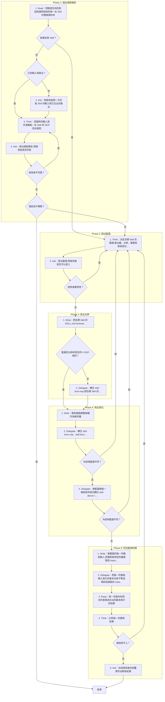
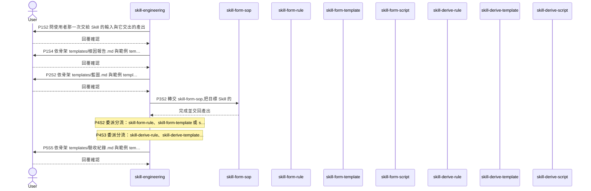

# SOP

🗺️ 流程視覺圖 (點擊展開/收合)

## Phase 1: 提出根因報告
1. Read 問題發生時的對話與當時用到的每一支 Skill 的整個資料夾;若要創建的是全新的 Skill → 跳至 Phase 2 Step 1;若對話裡有那一次交給 Skill 的輸入與它交出的產出 → 跳至 Phase 1 Step 3。
2. Ask 問使用者那一次交給 Skill 的輸入與它交出的產出。
3. Think 依 `rules/根因-規範.md` 用當時的輸入逐步演練每一支 Skill 的 SOP 找出根因。
4. Ask 依骨架 `templates/根因報告.md` 與範例 `templates/根因報告.example.md` 提出根因報告,問使用者是否同意;若使用者不同意 → 跳至 Phase 1 Step 3;若使用者同意,而每一個落差都不歸類 → 結束。

## Phase 2: 提出藍圖
1. Think 依 `rules/藍圖-規範.md` 決定目標 Skill 的藍圖:產出鏈、主幹、變更與新掛部位的樣子。
2. Ask 依骨架 `templates/藍圖.md` 與範例 `templates/藍圖.example.md` 提出藍圖,問使用者是否可以寫入;若使用者要修改 → 跳至 Phase 2 Step 1。

## Phase 3: 寫出主幹
1. Write 把目標 Skill 的 `SKILL.md` frontmatter 寫成藍圖的 name 與 description;若藍圖的主幹和現況的 `# SOP` 相同 → 跳至 Phase 4 Step 1。
2. Delegate 轉交 skill-form-sop,把目標 Skill 的 `# SOP` 寫成藍圖的主幹。

## Phase 4: 寫出部位
1. Write 刪除藍圖裡整個檔列為刪的檔。
2. Delegate 轉交 skill-form-rule、skill-form-template 或 skill-form-script,把藍圖裡有變更的既有檔改寫成終態;若寫出來的內容和藍圖不同 → 跳至 Phase 2 Step 1。
3. Delegate 替藍圖裡每一個新掛的部位轉交 skill-derive-rule、skill-derive-template 或 skill-derive-script,一次掛一步;若掛上去的內容和藍圖不同 → 跳至 Phase 2 Step 1。

## Phase 5: 列出驗收紀錄
1. Write 替藍圖的每一列驗收輸入,把實跑會改到的檔複製到 `tmp/verify/` 底下各自的資料夾。
2. Delegate 依骨架 `templates/實跑指示.md` 與範例 `templates/實跑指示.example.md` 把每一列驗收輸入與它的複本交給不帶這場對話脈絡的 subagent,實跑寫完的目標 Skill。
3. Read 每一份複本和原本的差異與交出的腳本執行的結果。
4. Think 比對每一份實跑結果;若驗收紀錄裡有一列判定為對不上 → 跳至 Phase 2 Step 1。
5. Ask 依骨架 `templates/驗收紀錄.md` 與範例 `templates/驗收紀錄.example.md` 在給使用者的回覆裡列出驗收紀錄。
