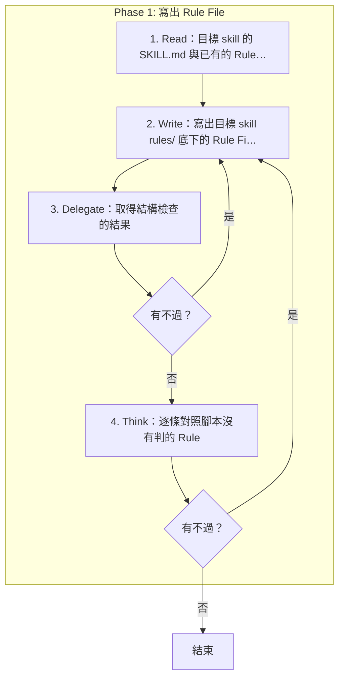

# SOP

🗺️ 流程視覺圖 (點擊展開/收合)

## Phase 1: 寫出 Rule File
1. Read 目標 skill 的 SKILL.md 與已有的 Rule File。
2. Write 依 `rules/RuleFile-格式規範.md` 把使用者要的規則寫成目標 skill `rules/` 底下的 Rule File。
3. Delegate 依 `rules/腳本執行-規範.md` 執行 `uv run scripts/check_rule_file.py --file <Rule File 的路徑>` 取得結構檢查的結果;若有不過 → 跳至 Phase 1 Step 2。
4. Think 逐條對照腳本沒有判的 Rule;若有不過 → 跳至 Phase 1 Step 2。
