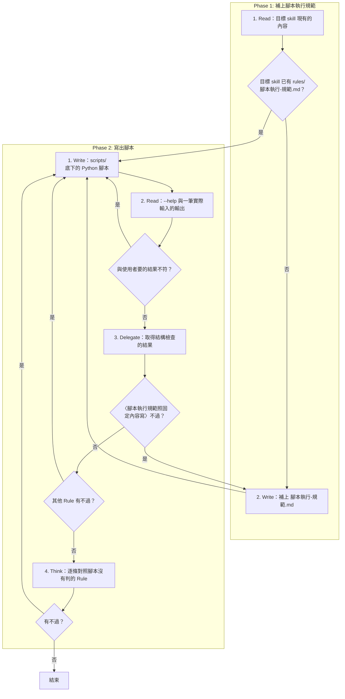

# SOP

## Phase 1: 補上腳本執行規範
1. Read **目標 skill 現有的內容**:SKILL.md、`rules/` 與 `scripts/` 底下已有的檔;若目標 skill 已有 `rules/腳本執行-規範.md` → 跳至 Phase 2 Step 1。
2. Write 依 `rules/腳本執行規範-格式規範.md` 在目標 skill 的 `rules/` **補上 `腳本執行-規範.md`**。

## Phase 2: 寫出腳本
1. Write 依 `rules/腳本-格式規範.md` 把使用者要的處理寫成目標 skill **`scripts/` 底下的 Python 腳本**。
2. Read 這支腳本以 `uv run` 執行 **`--help` 與一筆實際輸入的輸出**;若與使用者要的結果不符 → 跳至 Phase 2 Step 1。
3. Delegate 依 `rules/腳本執行-規範.md` 執行 `uv run scripts/check_scripts.py --skill <目標 skill 的根目錄>` **取得結構檢查的結果**;若〈腳本執行規範照固定內容寫〉不過 → 跳至 Phase 1 Step 2;若其他 Rule 有不過 → 跳至 Phase 2 Step 1。
4. Think **逐條對照腳本沒有判的 Rule**;若有不過 → 跳至 Phase 2 Step 1。

🗺️ 流程視覺圖 (點擊展開/收合)

