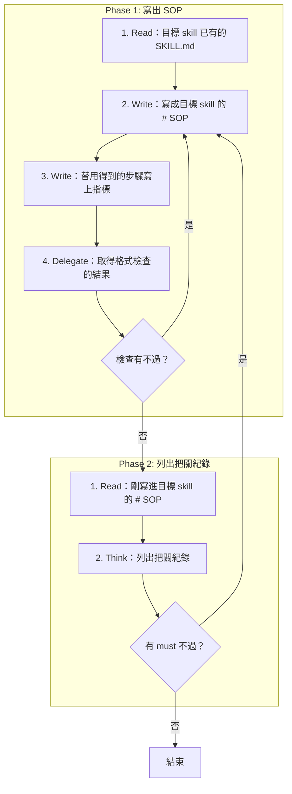

# SOP

## Phase 1: 寫出 SOP
1. Read **目標 skill 已有的 SKILL.md**。
2. Write 依 `rules/SOP-格式規範.md` 把使用者要的流程**寫成目標 skill 的 `# SOP`**。
3. Write 依 `rules/SOP-按需載入-格式規範.md` **替用得到的步驟寫上指標**。
4. Delegate 依 `rules/腳本執行-規範.md` 執行 `uv run scripts/render_sop_diagram.py --write --file <目標 SKILL.md 的路徑>` **取得格式檢查的結果**並產生流程視覺圖注入目標 skill 的 `SKILL.md` 檔尾;若檢查有不過 → 跳至 Phase 1 Step 2。

## Phase 2: 列出把關紀錄
1. Read **剛寫進目標 skill 的 `# SOP`**。
2. Think 依 `rules/把關紀錄-格式規範.md` **列出把關紀錄**;若有 must 不過 → 跳至 Phase 1 Step 2。

🗺️ 流程視覺圖 (點擊展開/收合)

