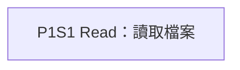
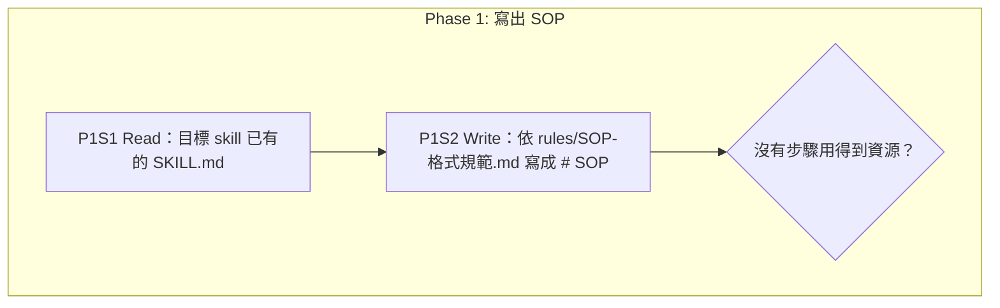
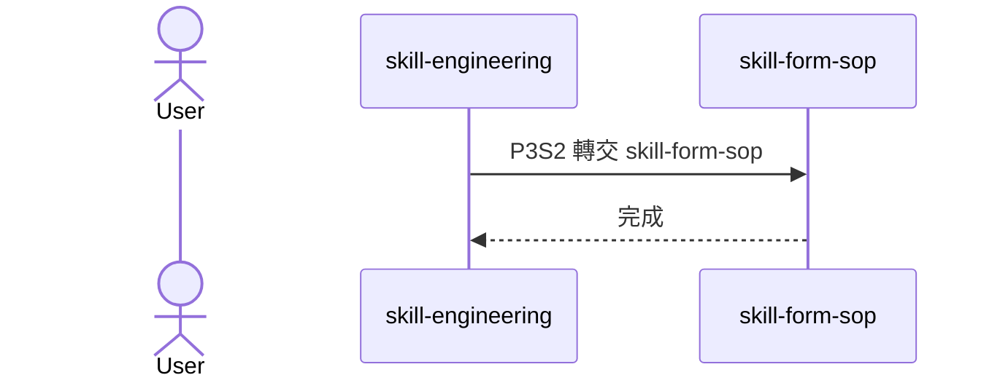
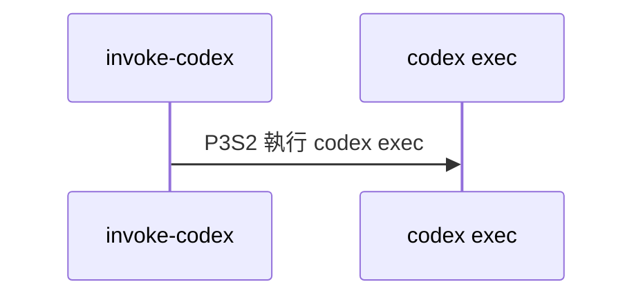

# Rule 1 [must] - 流程視覺圖置於 SOP 開頭並以折疊區塊包裹
- 視覺圖統一放置於目標 skill `SKILL.md` 的 `# SOP` 標題正下方、第一個 Phase 標題之前
- 外部使用 `<details open>` 與 `<summary>🗺️ 流程視覺圖 (點擊展開/收合)</summary>` 包裹,文末以 `</details>` 閉合
- 為什麼:統一收斂在 SOP 入口提供全域心智模型;以折疊標籤包裹可兼顧直觀瀏覽與模型上下文長度控制

## good example
- 視覺圖**放在 `# SOP` 正下方,並以 `<details open>` 折疊區塊包裹**
````markdown
# SOP

<details open>
<summary>🗺️ 流程視覺圖 (點擊展開/收合)</summary>


</details>

## Phase 1: 讀取檔案
1. Read 讀取檔案。
````

## bad example
- 同一份內容,但**視覺圖散落在 Phase 內部,且沒有折疊區塊**;排版凌亂且佔用上下文
````markdown
# SOP

## Phase 1: 讀取檔案

1. Read 讀取檔案。
````

# Rule 2 [must] - 基準視圖一律生成流程圖
- 每個 Skill 的視覺圖必備一張 Mermaid `flowchart TD` 流程圖(基準視圖)
- 以 Subgraph 劃分各 Phase,標明所有動作節點、決策菱形節點、跳轉邊與終止邊
- 為什麼:流程圖能忠實呈現完整的控制流程(CFG),讀者不需在條列文字中肉眼搜尋跳轉目標與迴圈

## good example
- **以 `flowchart TD` 呈現完整控制流程**,含 Subgraph 與條件分支判定


## bad example
- **未生成流程圖,或僅以文字條列代替視覺圖**;無法直觀看清分支與跳轉
```markdown
<details open>
<summary>🗺️ 流程視覺圖 (點擊展開/收合)</summary>
（無圖）
</details>
```

# Rule 3 [must] - 組合型 Skill 額外附加時序圖
- 當步驟包含 `Delegate 轉交 <skill-name>` 呼叫外部 Skill 時,判定為組合型 Skill,必須在流程圖下方額外附加一張 Mermaid `sequenceDiagram` 時序圖(協作視圖)
- 工具調用(例如 `Delegate 依 ... 執行 uv run ...` 或 `Delegate 執行 ...`)不判定為外部 Skill 呼叫,不附加時序圖
- 為什麼:時序圖適合宏觀展現主 Skill 與子 Skill 之間的職責轉交與互動邊界,一眼看清責任劃分;而單純執行腳本是工具調用,不應混淆為多 Skill 協作

## good example
- 包含 `Delegate 轉交 skill-form-sop` 的組合型 Skill,**在流程圖後附加時序圖**


## bad example
- 只有調用 CLI 或 Python 腳本的單一 Skill,**誤將腳本調用畫成時序圖中的 Skill lifeline**


# Rule 4 [must] - 視覺圖由文字 SOP 自動編譯生成
- 視覺圖必須由 `scripts/render_sop_diagram.py` 自動編譯產生,嚴禁手動補寫或竄改
- 圖形節點標籤引號與特殊字元由腳本統一轉義,確保 Mermaid 語法正確
- 為什麼:貫徹 SSOT(單一事實來源)原則;手繪圖極易與文字 SOP 產生分歧,文字修改而圖未改會形成嚴重資訊衝突

## good example
- **透過腳本自動解析編譯並就地注入**,圖文完全對齊一致
```bash
$ uv run scripts/render_sop_diagram.py --write --file .claude/skills/demo/SKILL.md
```

## bad example
- **手動在 SKILL.md 繪製流程圖**,文字修改後未更新圖形,導致圖中跳轉步驟與文字描述不一致
```markdown
# 手動繪製但步驟編號已脫節的圖形
```
