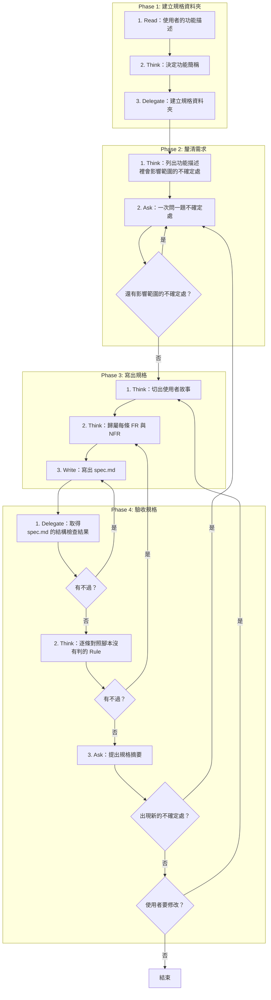

# SOP

## Phase 1: 建立規格資料夾
1. Read **使用者的功能描述**。
2. Think **決定功能簡稱**:2 到 4 個英文單字的 kebab-case。
3. Delegate 依 `rules/腳本執行-規範.md` 執行 `uv run scripts/create_feature.py --short-name <功能簡稱>` **建立規格資料夾**。

## Phase 2: 釐清需求
1. Think 依 `rules/釐清-規範.md` **列出功能描述裡會影響範圍的不確定處**。
2. Ask **一次問一題不確定處**並記下回答;若還有影響範圍的不確定處 → 跳至 Phase 2 Step 2。

## Phase 3: 寫出規格
1. Think **切出使用者故事**:每個故事可獨立測試,並排出優先順序。
2. Think 依 `rules/需求歸屬-規範.md` **歸屬每條 FR 與 NFR**:放進所屬的使用者故事或全域需求。
3. Write 依骨架 `templates/spec.template.md` 與範例 `templates/spec.template.example.md` **寫出 spec.md**。

## Phase 4: 驗收規格
1. Delegate 執行 `uv run scripts/check_spec.py --spec <spec.md 的路徑>` **取得 spec.md 的結構檢查結果**;若有不過 → 跳至 Phase 3 Step 3。
2. Think **逐條對照腳本沒有判的 Rule**;若有不過 → 跳至 Phase 3 Step 2。
3. Ask **提出規格摘要**,問使用者是否同意;若出現新的不確定處 → 跳至 Phase 2 Step 2;若使用者要修改 → 跳至 Phase 3 Step 1。

🗺️ 流程視覺圖 (點擊展開/收合)

