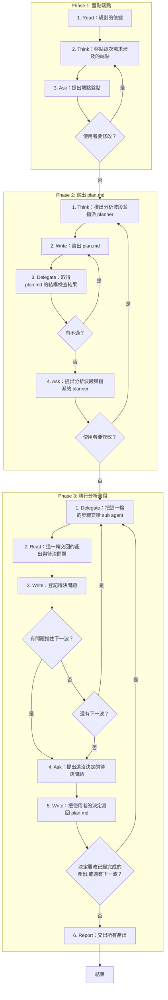

# SOP

## Phase 1: 盤點端點
1. Read **規劃的依據**:spec.md、research.md 與 techstack.md。
2. Think 依 `rules/端點-規範.md` **盤點這次需求涉及的端點**:每個端點視為一個獨立系統,寫出它對外的介面與需求出處。
3. Ask **提出端點盤點**,問使用者是否要增減;若使用者要修改 → 跳至 Phase 1 Step 2。

## Phase 2: 寫出 plan.md
1. Think 依 `rules/波段-規範.md` **排出分析波段並指派 planner**:每個介面至少占一個步驟,同一波的介面彼此不依賴。
2. Write 依骨架 `templates/plan.md` 與範例 `templates/plan.example.md` 在 spec.md 所在的資料夾**寫出 plan.md**。
3. Delegate 依 `rules/腳本執行-規範.md` 執行 `uv run scripts/check_plan.py --plan <plan.md 的路徑> --spec <spec.md 的路徑>` **取得 plan.md 的結構檢查結果**;若有不過 → 跳至 Phase 2 Step 2。
4. Ask **提出分析波段與指派的 planner**,問使用者是否同意;若使用者要修改 → 跳至 Phase 2 Step 1。

## Phase 3: 執行分析波段
1. Delegate 依骨架 `templates/委派指示.md` 與範例 `templates/委派指示.example.md` **把這一輪的步驟交給 sub agent**:還沒完成的最前面一波或使用者要重做的步驟,一支 planner 一個 sub agent,同一波平行。
2. Read **這一輪交回的產出與待決問題**。
3. Write 依 `rules/待決問題-規範.md` 在 plan.md **登記待決問題**:每一題標出它擋住哪幾步;若有問題擋住下一波 → 跳至 Phase 3 Step 4;若還有下一波 → 跳至 Phase 3 Step 1。
4. Ask **提出還沒決定的待決問題**,問使用者每一題怎麼決定。
5. Write **把使用者的決定寫回 plan.md**;若決定要改已經完成的產出,或還有下一波 → 跳至 Phase 3 Step 1。
6. Report **交出所有產出**:每個檔的路徑,以及打開原型的方式。

🗺️ 流程視覺圖 (點擊展開/收合)

