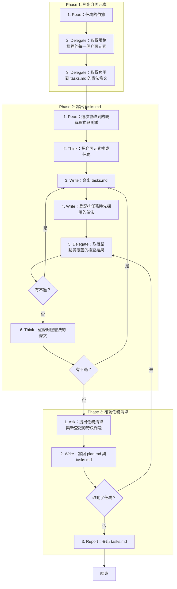

# SOP

## Phase 1: 列出介面元素
1. Read **任務的依據**:spec.md、research.md、techstack.md、plan.md,以及 plan.md Documentation 樹列出的每一個規格檔與原型。
2. Delegate 依 `rules/腳本執行-規範.md` 執行 `uv run scripts/list_elements.py --package <spec package 的路徑>` **取得規格檔裡的每一個介面元素**。
3. Delegate 執行 `uv run scripts/constitution_rules.py --constitution <專案根目錄>/constitution --artifact tasks/tasks` **取得套用到 tasks.md 的憲法條文**。

## Phase 2: 寫出 tasks.md
1. Read **這次會改到的既有程式與測試**:plan.md Source Code 樹列出要改或移除的既有檔、前一迭代 tasks.md 的介面覆蓋表,以及被改掉或移除的符號在既有程式裡的每一個呼叫端。
2. Think 依 `rules/任務-規範.md` **把介面元素排成任務**:每個元素歸到一個 phase,至少有一個實作任務與一個測試任務;每條 SC 都有量測任務。
3. Write 依 `rules/憲法-規範.md`、骨架 `templates/tasks.md` 與範例 `templates/tasks.example.md` 在 spec.md 所在的資料夾**寫出 tasks.md**。
4. Write 在 plan.md 的待決問題**登記排任務時先採用的做法**:「提出的步驟」欄寫 `tasks`、「擋住」欄寫「—」、「決定」欄寫「待決」,每一題附上可選的做法並標出先採用的那一種。
5. Delegate 執行 `uv run scripts/check_tasks.py --tasks <tasks.md 的路徑> --package <spec package 的路徑>` **取得錨點與覆蓋的檢查結果**;若有不過 → 跳至 Phase 2 Step 3。
6. Think **逐條對照憲法的條文**;若有不過 → 跳至 Phase 2 Step 3。

## Phase 3: 確認任務清單
1. Ask **提出任務清單與新登記的待決問題**,問使用者每一題怎麼決定、任務要不要修改。
2. Write 把使用者的決定**寫回 plan.md 與 tasks.md**;若改動了任務 → 跳至 Phase 2 Step 5。
3. Report **交出 tasks.md**,附上憲法的對照結果:路徑、每個 phase 的任務數與可以平行的任務,以及下一步跑 `/analyze`。

🗺️ 流程視覺圖 (點擊展開/收合)

