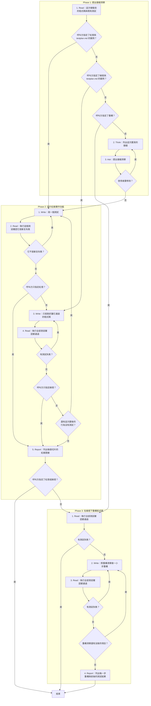

# SOP

## Phase 1: 提出接縫清單
1. Read **這次會動到的程式碼與既有測試**,專案有 `GLOSSARY.md` 與這一區的 ADR 時一併讀;若呼叫方指定了紅燈與 `testplan.md` 的案例 → 跳至 Phase 2 Step 1;若呼叫方指定了綠燈與 `testplan.md` 的案例 → 跳至 Phase 2 Step 3;若呼叫方指定了重構 → 跳至 Phase 3 Step 1。
2. Think 依 `rules/接縫-規範.md` **列出這次要測的接縫**。
3. Ask 依骨架 `templates/接縫清單.md` 與範例 `templates/接縫清單.example.md` **提出接縫清單**,問使用者是否同意只在這些接縫測試;若使用者要修改 → 跳至 Phase 1 Step 2。

## Phase 2: 逐片紅綠實作功能
1. Write 依 `rules/測試-規範.md`、骨架 `templates/測試.py` 與範例 `templates/測試.example.py` 在一個確認過的接縫**寫一個測試**。
2. Read 依 `rules/紅燈-規範.md` **執行這個測試確認它是斷言失敗**;若它不是斷言失敗 → 跳至 Phase 2 Step 1;若呼叫方只指定紅燈 → 跳至 Phase 2 Step 5。
3. Write 依 `rules/實作-規範.md` **只寫剛好讓它通過的程式碼**。
4. Read **執行全部測試確認都通過**;若有測試失敗 → 跳至 Phase 2 Step 3;若呼叫方只指定綠燈 → 跳至 Phase 2 Step 5;若還有這次要做的行為沒有測試 → 跳至 Phase 2 Step 1。
5. Report **列出每個切片的紅綠證據**:測試名稱、紅燈時的失敗訊息與綠燈時的測試結果,以及這一輪記下的重構清單;若呼叫方指定了紅燈或綠燈 → 結束。

## Phase 3: 在綠燈下重構程式碼
1. Read **執行全部測試確認都通過**;若有測試失敗 → 結束。
2. Write 依 `rules/重構-規範.md` **照重構清單做一小步重構**。
3. Read **執行全部測試確認都通過**;若有測試失敗 → 跳至 Phase 3 Step 2;若重構清單還有沒做的項目 → 跳至 Phase 3 Step 2。
4. Report **列出每一步重構與前後的測試結果**。

🗺️ 流程視覺圖 (點擊展開/收合)

