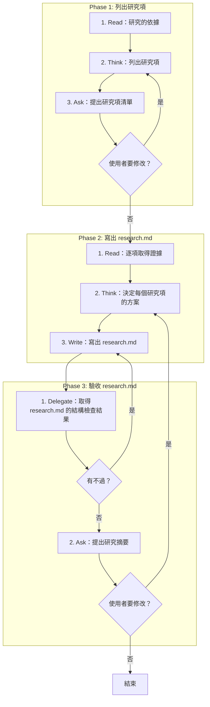

# SOP

## Phase 1: 列出研究項
1. Read **研究的依據**:spec.md、專案憲法與使用者指定的技術方向。
2. Think **列出研究項**:每個會影響實作的技術未知數或選型,標出它對應的 FR、NFR、SC、憲法原則或使用者指定。
3. Ask **提出研究項清單**,問使用者是否要增減;若使用者要修改 → 跳至 Phase 1 Step 2。

## Phase 2: 寫出 research.md
1. Read 依 `rules/證據-規範.md` **逐項取得證據**:能實測的在 session 暫存區寫探針實測,不能實測的估算或查證來源,記下環境、依據或來源。
2. Think **決定每個研究項的方案**,以及考慮過但否決的替代方案與原因。
3. Write 依骨架 `templates/research.template.md` 與範例 `templates/research.template.example.md` 在 spec.md 所在的資料夾**寫出 research.md**。

## Phase 3: 驗收 research.md
1. Delegate 依 `rules/腳本執行-規範.md` 執行 `uv run scripts/check_research.py --research <research.md 的路徑>` **取得 research.md 的結構檢查結果**;若有不過 → 跳至 Phase 2 Step 3。
2. Ask **提出研究摘要**,問使用者是否同意;若使用者要修改 → 跳至 Phase 2 Step 2。

🗺️ 流程視覺圖 (點擊展開/收合)

