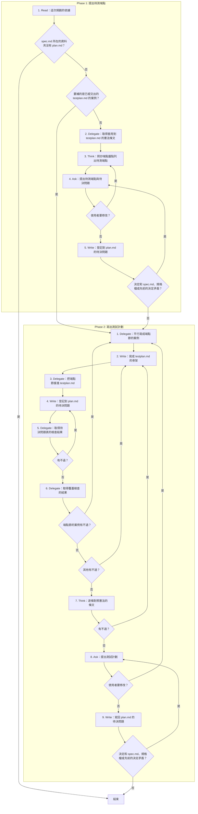

# SOP

## Phase 1: 提出待測端點
1. Read **這次規劃的依據**:spec.md、plan.md 的端點盤點與它指到的規格檔與原型、techstack.md、research.md,以及範疇內已經有的程式碼與測試,包含測試裡代替真元件的替身;若 spec.md 所在的資料夾沒有 plan.md → 結束;若要補的是已經交出的 testplan.md 的案例 → 跳至 Phase 2 Step 1。
2. Delegate 依 `rules/腳本執行-規範.md` 執行 `uv run scripts/constitution_rules.py --constitution <專案根目錄>/constitution --artifact testplan/testplan` **取得套用到 testplan.md 的憲法條文**。
3. Think 依 `rules/待測端點-規範.md` **照抄端點盤點列出待測端點**:每個端點的代號、介面規格檔、公開接縫、受測操作與規格錨點、接縫的取捨、替身,以及上游沒寫到的待決問題。
4. Ask 依骨架 `templates/testplan.md` 與範例 `templates/testplan.example.md` **提出待測端點與待決問題**,問使用者是否同意只在這些端點與操作上規劃測試、每一題怎麼決定;若使用者要修改 → 跳至 Phase 1 Step 3。
5. Write 依 `rules/決定-規範.md` 把使用者的決定**登記到 plan.md 的待決問題**;若決定和 spec.md、規格檔或先前的決定矛盾 → 跳至 Phase 1 Step 4。

## Phase 2: 寫出測試計劃
1. Delegate 依 `rules/委派-規範.md`、骨架 `templates/端點節指示.md` 與範例 `templates/端點節指示.example.md` 把每個要寫或要補的端點節交給 subagent **平行寫成端點節的案例**。
2. Write 依 `rules/測試案例-規範.md` 把跨端點驗收、全域測試區的測試案例與每個端點節的位置**寫成 testplan.md 的骨架**。
3. Delegate 執行 `uv run scripts/assemble_testplan.py --skeleton <骨架的路徑> --parts <端點節檔案的資料夾> --out <testplan.md 的路徑>` **把端點節接進 testplan.md**。
4. Write 把端點節交回的待決問題**登記到 plan.md 的待決問題**。
5. Delegate 執行 `uv run scripts/check_plan.py --plan <plan.md 的路徑> --spec <spec.md 的路徑>`(spec.md 註明建立在前一次迭代之上時,再加 `--previous-plan <前一次迭代的 plan.md 的路徑>`)**取得待決問題表的檢查結果**;若有不過 → 跳至 Phase 2 Step 4。
6. Delegate 執行 `uv run scripts/check_testplan.py --spec <spec.md 的路徑> --plan <testplan.md 的路徑> --contracts <spec package 的 contracts 資料夾>` **取得覆蓋檢查的結果**;若端點節的案例有不過 → 跳至 Phase 2 Step 1;若其他有不過 → 跳至 Phase 2 Step 2。
7. Think 依 `rules/憲法-規範.md` **逐條對照憲法的條文**;若有不過 → 跳至 Phase 2 Step 2。
8. Ask **提出測試計劃**、新登記的待決問題與會碰到正式資料或共用服務的實跑案例,問使用者是否同意照它交給 `/tasks`、每一題怎麼決定、這些案例可不可以照寫的護欄執行;若使用者要修改 → 跳至 Phase 2 Step 1。
9. Write 把使用者的決定**寫回 plan.md 的待決問題**;若決定和 spec.md、規格檔或先前的決定矛盾 → 跳至 Phase 2 Step 8。

🗺️ 流程視覺圖 (點擊展開/收合)

