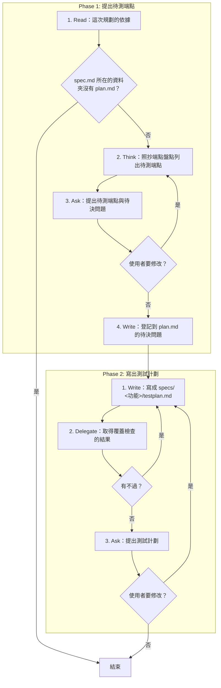

# SOP

## Phase 1: 提出待測端點
1. Read **這次規劃的依據**:spec.md、plan.md 的端點盤點與它指到的規格檔與原型、techstack.md、research.md,以及範疇內已經有的程式碼與測試,包含測試裡代替真元件的替身;若 spec.md 所在的資料夾沒有 plan.md → 結束。
2. Think 依 `rules/待測端點-規範.md` **照抄端點盤點列出待測端點**:每個端點的代號、介面規格檔、公開接縫、受測操作與規格錨點、接縫的取捨、替身,以及上游沒寫到的待決問題。
3. Ask 依骨架 `templates/testplan.md` 與範例 `templates/testplan.example.md` **提出待測端點與待決問題**,問使用者是否同意只在這些端點與操作上規劃測試、每一題怎麼決定;若使用者要修改 → 跳至 Phase 1 Step 2。
4. Write 把使用者的決定**登記到 plan.md 的待決問題**。

## Phase 2: 寫出測試計劃
1. Write 依 `rules/測試案例-規範.md` 照確認過的待測端點,把每個使用者故事的端點節、跨端點驗收與全域測試區的測試案例**寫成 `specs/<功能>/testplan.md`**。
2. Delegate 依 `rules/腳本執行-規範.md` 執行 `uv run scripts/check_testplan.py --spec <spec.md 的路徑> --plan <testplan.md 的路徑>` **取得覆蓋檢查的結果**;若有不過 → 跳至 Phase 2 Step 1。
3. Ask **提出測試計劃**與會碰到正式資料或共用服務的實跑案例,問使用者是否同意照它交給 `/tasks`、這些案例可不可以照寫的護欄執行;若使用者要修改 → 跳至 Phase 2 Step 1。

🗺️ 流程視覺圖 (點擊展開/收合)

