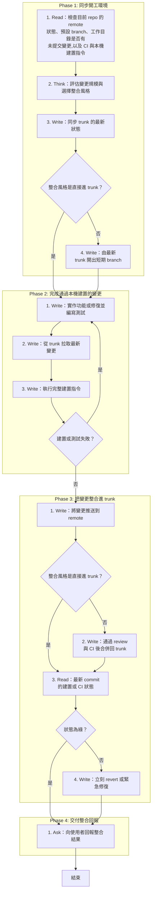

# SOP

## Phase 1: 同步開工環境
1. Read 檢查目前 repo 的 remote 狀態、預設 branch、工作目錄是否有未提交變更,以及 CI 與本機建置指令。
2. Think 依 `rules/開工判斷-規範.md` **評估變更規模與選擇整合風格**(直接進 trunk 或短期 branch)。
3. Write **同步 trunk 的最新狀態**;若整合風格是直接進 trunk → 跳至 Phase 2 Step 1。
4. Write **由最新 trunk 開出短期 branch**。

## Phase 2: 完成通過本機建置的變更
1. Write 依 `rules/分支與變更-規範.md` **實作功能或修復並編寫測試**,在本機形成 commit;長變更使用 feature flag 或 branch by abstraction 隔絕未完成功能。
2. Write 以 `--autostash` **從 trunk 拉取最新變更**並帶入本機,並在本機解決衝突。
3. Write 在本機**執行完整建置指令**(編譯與所有測試),確認全部通過;若建置或測試失敗 → 跳至 Phase 2 Step 1。

## Phase 3: 把變更整合進 trunk
1. Write **將變更推送到 remote**;若整合風格是直接進 trunk → 跳至 Phase 3 Step 3。
2. Write 發起 PR,**通過 review 與 CI 後合併回 trunk**,並立刻刪除短期 branch。
3. Read 確認 remote trunk 上**最新 commit 的建置或 CI 狀態**;若狀態為綠 → 跳至 Phase 4 Step 1。
4. Write **立刻 revert 或緊急修復**,讓 remote trunk 回到綠燈。

## Phase 4: 交付整合回報
1. Ask 依骨架 `templates/整合回報.md` 與範例 `templates/整合回報.example.md` **向使用者回報整合結果**,列出切法、整合風格、本機建置證據、trunk 狀態與留下的開關或技術債。

🗺️ 流程視覺圖 (點擊展開/收合)

