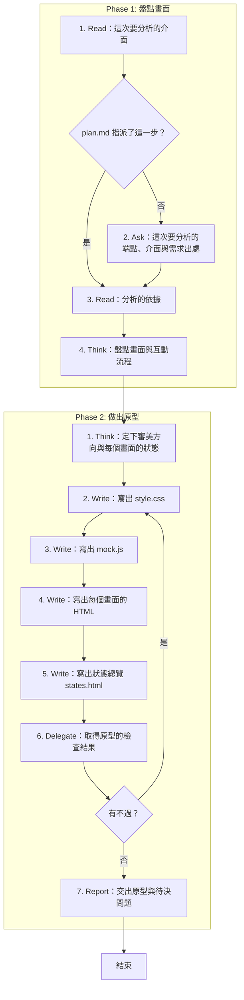

# SOP

## Phase 1: 盤點畫面
1. Read **這次要分析的介面**:plan.md 的端點盤點與波段表裡指派給這次的那一步;若 plan.md 指派了這一步 → 跳至 Phase 1 Step 3。
2. Ask 問使用者**這次要分析的端點、介面與需求出處**。
3. Read **分析的依據**:spec.md、research.md、techstack.md,以及這一步的理由欄點名的前幾步產出。
4. Think **盤點畫面與互動流程**:每個需求出處都要對到至少一個畫面。

## Phase 2: 做出原型
1. Think 依 `rules/原型-規範.md` **定下審美方向與每個畫面的狀態**。
2. Write 依骨架 `templates/style.css` 與範例 `templates/style.example.css` 在 plan.md 的 Documentation 樹替這一步列的資料夾(沒有 plan.md 時是 spec.md 旁的 `prototype/`)**寫出 `style.css`**。
3. Write 依骨架 `templates/mock.js` 與範例 `templates/mock.example.js` 在同一個資料夾**寫出 `mock.js`**。
4. Write 依骨架 `templates/page.html` 與範例 `templates/page.example.html` 在同一個資料夾**寫出每個畫面的 HTML**:入口是 `index.html`。
5. Write 依骨架 `templates/states.html` 與範例 `templates/states.example.html` 在同一個資料夾**寫出狀態總覽 `states.html`**:每個畫面的每個狀態各一格。
6. Delegate 依 `rules/腳本執行-規範.md` 執行 `uv run scripts/check_prototype.py --prototype <prototype 資料夾的路徑> --plan <plan.md 的路徑> --spec <spec.md 的路徑> --step <S 編號>` **取得原型的檢查結果**;若有不過 → 跳至 Phase 2 Step 2。
7. Report **交出原型與待決問題**:附上打開入口 `index.html` 與狀態總覽 `states.html` 的方式,拿不準、要使用者決定的事一起列在這裡。

🗺️ 流程視覺圖 (點擊展開/收合)

