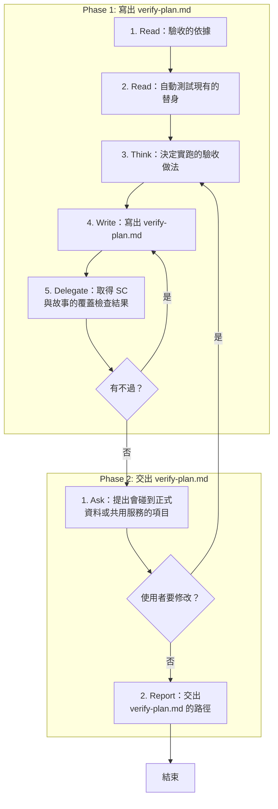

# SOP

## Phase 1: 寫出 verify-plan.md
1. Read **驗收的依據**:spec.md、research.md、plan.md 與它列出的規格檔。
2. Read **自動測試現有的替身**:專案測試裡假的外部工具、前端函式庫與服務。
3. Think 依 `rules/驗收-規範.md` 逐條 SC 與使用者故事**決定實跑的驗收做法**。
4. Write 依骨架 `templates/verify-plan.md` 與範例 `templates/verify-plan.example.md` 在 spec.md 所在的資料夾**寫出 verify-plan.md**。
5. Delegate 依 `rules/腳本執行-規範.md` 執行 `uv run scripts/check_verify_plan.py --verify-plan <verify-plan.md 的路徑> --spec <spec.md 的路徑>` **取得 SC 與故事的覆蓋檢查結果**;若有不過 → 跳至 Phase 1 Step 4。

## Phase 2: 交出 verify-plan.md
1. Ask **提出會碰到正式資料或共用服務的項目**,問使用者是否同意;若使用者要修改 → 跳至 Phase 1 Step 3。
2. Report **交出 verify-plan.md 的路徑**與下一步跑 tasks。

🗺️ 流程視覺圖 (點擊展開/收合)

