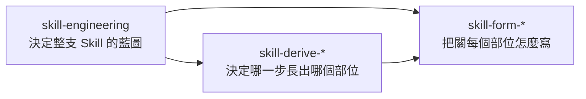

# BDGG-Dev-Skills

我在水球軟體學院《AI x BDD》課程做的 Agent Skills,目前 17 支。

每一支都是同一種結構:`SKILL.md` 只放一段短的 SOP,規則、樣板與腳本拆成獨立的檔,走到用得到的那一步才載入。這個結構本身也由這裡的 Skill 把關 —— 其中 10 支就是用來造 Skill 的。

## Skills

### 造 Skill 的 Skill

要創建或優化一支 Skill,從 `skill-engineering` 進來,其餘各支由它轉交。

| Skill | 做什麼 |
|---|---|
| [`skill-engineering`](./.claude/skills/skill-engineering/) | 創建或優化一支 Skill:先找根因、提藍圖,使用者確認後才轉交下面各支寫入,最後交給不帶脈絡的 subagent 實跑驗收 |
| [`skill-form-sop`](./.claude/skills/skill-form-sop/) | 把關 `SKILL.md` 的 SOP 怎麼寫,並產生檔尾的流程圖 |
| [`skill-form-rule`](./.claude/skills/skill-form-rule/) | 把關 `rules/` 底下的 Rule File |
| [`skill-form-template`](./.claude/skills/skill-form-template/) | 把關 `templates/` 底下的骨架與範例 |
| [`skill-form-script`](./.claude/skills/skill-form-script/) | 把關 `scripts/` 底下的 Python 腳本 |
| [`skill-derive-rule`](./.claude/skills/skill-derive-rule/) | 把 SOP 的某一步展開成按需載入的 Rule File |
| [`skill-derive-template`](./.claude/skills/skill-derive-template/) | 把某一步的輸出格式抽成樣板 |
| [`skill-derive-script`](./.claude/skills/skill-derive-script/) | 把某一步的機械工作委派給腳本 |
| [`skill-conform`](./.claude/skills/skill-conform/) | 規範改了之後,檢查既有的 Skill 並改到符合 |
| [`skill-diagnose`](./.claude/skills/skill-diagnose/) | Skill 的產出不符預期、原因又不確定時,用假說排查與對照實驗找出根因 |



### 開發流程

| Skill | 做什麼 |
|---|---|
| [`double-diamond-principle`](./.claude/skills/double-diamond-principle/) | 動手之前依雙鑽石走過探查問題、確立問題簡報、比較候選方案、驗證後交付 |
| [`trunk-based-development`](./.claude/skills/trunk-based-development/) | 把變更切小,本機建置通過後整合回 trunk,並確認 trunk 維持綠燈 |
| [`git-conventional-commit`](./.claude/skills/git-conventional-commit/) | 把混在一起的變更拆成一筆一筆的 commit,依 Conventional Commits 1.0.0 寫訊息 |
| [`plan-with-class-diagram`](./.claude/skills/plan-with-class-diagram/) | 寫程式之前先用 Mermaid 類別圖提案,確認後按圖實作 |

前三支整理自公開的文獻,原文在這裡可以核對:

- `double-diamond-principle`:Design Council 的 [Framework for Innovation](https://www.designcouncil.org.uk/resources/framework-for-innovation/) 與 [The Double Diamond](https://www.designcouncil.org.uk/resources/the-double-diamond/),以 [CC BY 4.0](https://creativecommons.org/licenses/by/4.0/) 授權。這支 Skill 是為軟體開發所做的轉譯,內容經過改寫,不代表 Design Council 的立場。
- `trunk-based-development`:[trunkbaseddevelopment.com](https://trunkbaseddevelopment.com/)(作者 Paul Hammant 與貢獻者)。這支 Skill 是摘要與轉述,原文版權屬原作者。
- `git-conventional-commit`:[Conventional Commits 1.0.0](https://www.conventionalcommits.org/en/v1.0.0/),以 [CC BY 3.0](https://creativecommons.org/licenses/by/3.0/) 授權;type 的定義另外參考 [Angular Commit Message Guidelines](https://github.com/angular/angular/blob/22b96b9/CONTRIBUTING.md#-commit-message-guidelines)。

改寫成 SOP 之前、逐頁標出處的版本留在 tag [`task1-v1`](https://github.com/AI-x-BDD/BDGG-Dev-Skills/tree/task1-v1/.claude/skills)。

### 委派給其他 CLI agent

| Skill | 做什麼 |
|---|---|
| [`invoke-codex`](./.claude/skills/invoke-codex/) · [`invoke-agy`](./.claude/skills/invoke-agy/) · [`invoke-copilot`](./.claude/skills/invoke-copilot/) | 組裝任務指示,以非互動模式調用 Codex、Antigravity 或 GitHub Copilot CLI,判定這次調用有沒有成功並驗收結果 |

## 一支 Skill 的結構

```
<Skill 名稱>/
├── SKILL.md      # SOP:Phase 底下一行一步,每一步以一個動詞開頭;檔尾的流程圖由腳本產生
├── rules/        # 某一步要遵守的規則:標 must 或 should,附同一個案例的 good / bad example
├── templates/    # 某一步輸出的格式:骨架與範例兩個檔成對
└── scripts/      # 某一步交給程式做的機械工作:Python,以 uv run 執行
```

`SKILL.md` 每次觸發都會整份讀進來,所以只留流程;其餘三種部位由用到它的那一步點名,走到那一步才讀。

## 使用

```bash
git clone https://github.com/AI-x-BDD/BDGG-Dev-Skills
cp -r BDGG-Dev-Skills/.claude/skills/<Skill 名稱> <你的專案>/.claude/skills/
```

- Codex 這類讀 `.agents/` 的 agent 改從 `.agents/skills/` 複製,兩份內容相同。
- 帶 `scripts/` 的 Skill 以 [uv](https://docs.astral.sh/uv/) 執行腳本,要先裝好。
- 造 Skill 的那 10 支會互相轉交,請整組一起複製。

要在這個 repo 裡改 Skill,先執行一次 `git config core.hooksPath .githooks`:只改 `.claude/skills/` 那一份,提交時會自動鏡像到 `.agents/skills/`,並檢查每一支是否符合格式規範。

## 道館作業

各座道館的 Skills 都累積在這個 repo,每次繳交用 tag 標記當時的版本;每一座的證據與我的觀察紀錄放在 `docs/`。

| 道館 | 繳交版本 | 證據 |
|---|---|---|
| 一:組合三支 Skills(git / TBD / 雙菱形) | [`task1-v1`](https://github.com/AI-x-BDD/BDGG-Dev-Skills/tree/task1-v1) | [`docs/task1_skill_creator/`](./docs/task1_skill_creator/) |
| 二:自己做出 Skill Engineering,再用它優化道館一的三支 Skills | [`task2-v1`](https://github.com/AI-x-BDD/BDGG-Dev-Skills/tree/task2-v1) | [`docs/task2_skill_engineering/`](./docs/task2_skill_engineering/) |

## 驗證狀態

17 支的 `description` 都以「(未驗證)」結尾。格式由檢查腳本把關;行為上實際跑過什麼、還沒跑過什麼,寫在各座道館的證據頁。

## 交流

這些 Skills 歡迎直接取用,或依你的專案調整。有使用上的問題或改進建議,歡迎開 issue。

---

## 官方宣告（以下區塊請保留）

本 repo 為[水球軟體學院](https://world.waterballsa.tw)《AI x BDD：規格驅動全自動化開發術》課程的學員產出，用於公告課程中道館作業的展示，並依[官方 Template](https://github.com/AI-x-BDD/aixbdd-skill-homework-template) 建立。

《AI x BDD：規格驅動全自動化開發術》課程四大特色：

1. **【軟工方法論＋結果導向】**
   只談 AI coding 不談軟工方法論，是不學無術！課程中強調結果導向的開發方法：只要訂好驗收標準，就可以 One-Shot 開發到位！
2. **【最完整的 SDD 概念與實作】**
   市面上最完整的 SDD 課程，一次教你 Skills、SDD、TDD、BDD 的知識與實踐，輕鬆實踐高效可靠全自動開發。
3. **【企業級實戰導入】**
   用企業級實踐導入高規格，不只學會工具，更知道如何舉一反三完全客製化企業專案需求。
4. **【課程教學方式與物超所值】**
   這是一堂理論、實務跟實戰三者兼具的 SDD 線上課程，用工作坊級別的學習體驗，不是只是教概念，而是直接帶著做！

[了解更多課程內容說明](https://waterballs.tw/Ghl6O)

## 開源專案：AI x BDD

水球老師把這套 AI x BDD 的方法論做成開源 pipeline skill：把產品迭代寫成 Gherkin，再一路帶到 RED → GREEN → REFACTOR。

覺得有幫助，歡迎給它一顆 Star：

[](https://github.com/Waterball-Software-Academy/aixbdd)

## 相關問題洽詢管道

1. [水球軟體學院 LINE 官方帳號](https://lin.ee/STIsOLZ)
2. 客服信箱：[support@waterballsa.tw](mailto:support@waterballsa.tw)
3. [水球軟體學院（社群）Discord](https://discord.gg/Ymjz7NmZXn)

---

© 2026 水球球特務有限公司版權所有，侵害必究。
